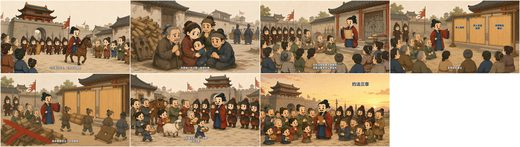
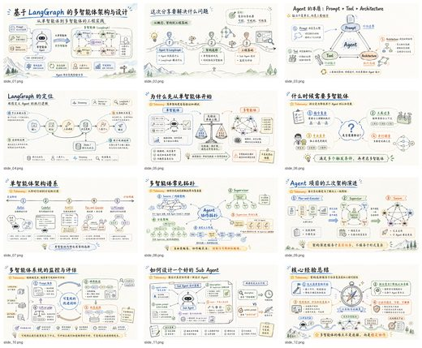

# Awesome Codex Skills

[中文](README.zh-CN.md)

Open-source **skills, plugins and workflows made for OpenAI Codex**: single skills, skill collections, plugins and MCP servers, subagent workflows, bridges to other agents, and tooling for Codex itself. 205 repos, each one read and security-graded by [Agent Skills Hub (agentskillshub.top)](https://agentskillshub.top).

Live page with filters: **[https://agentskillshub.top/best/codex-skills/](https://agentskillshub.top/best/codex-skills/)** · refreshed every 8 hours

## Which one to install

We ran 12 of these end to end (12 gave a result). This is what we would pick; the [full test](#tested) is below.

- 🥇 **For slide decks: [codex-ppt-skill](https://github.com/ningzimu/codex-ppt-skill)**  
  Opened every time in Codex, even with 500 other skills installed and its description stripped (17 of 18 over both agents): the name says what it does. It also took over the requests meant for another deck skill, so install one deck skill, not several.
- 🥈 **To make image slides editable: [image-to-editable-ppt-skill](https://github.com/ningzimu/image-to-editable-ppt-skill)**  
  18 of 18, and a different job from the one above, so the two do not compete.
- 🥉 **To keep Codex itself fast: [keep-codex-fast](https://github.com/vibeforge1111/keep-codex-fast)**  
  18 of 18. A maintenance skill: a read-only report first, backups before any change.

**Fine alone, lost in a crowd (Codex with 500 others installed):** CyberPPT (0 of 3: every request went to codex-ppt); codex-startup-pressure-test-skill (0 of 3, like the three other skills whose names come late in the alphabet).

Whichever you pick: keep the number of installed skills low in Codex. With 512 installed it dropped every description and hid 134 skills, and the right skill was opened 17 times of 36, against 35 or 36 with up to 112 installed.

*Ranked by how often the right skill was opened, over 18 tries each (three requests, three crowding levels, two agents), then GitHub stars. This measures whether the agent finds the skill, not how good its output is. One run per request; the requests were written from each skill's own description.*

## What these Codex skills make

<table>
<tr>
<td align="center" valign="top" width="33%"><b>📚 Collections</b> 18 repos  Many Codex skills or plugins in one repository. <a href="#type-collection"><b>View the list →</b></a></td>
<td align="center" valign="top" width="33%"><b>🧩 Skills</b> 100 repos   One skill, or a small set, for a specific job. <a href="#type-skill"><b>View the list →</b></a></td>
<td align="center" valign="top" width="33%"><b>🔌 Plugins & MCP</b> 55 repos  Plugins, extensions and MCP servers that give Codex new abilities. <a href="#type-plugin"><b>View the list →</b></a></td>
</tr>
<tr>
<td align="center" valign="top" width="33%"><b>🗺 Workflows & subagents</b> 13 repos  Subagents, planning and long-running task workflows. <a href="#type-workflow"><b>View the list →</b></a></td>
<td align="center" valign="top" width="33%"><b>🌉 Bridges to other agents</b> 9 repos  Connect Codex with Claude Code, Gemini CLI, Cursor and others. <a href="#type-bridge"><b>View the list →</b></a></td>
<td align="center" valign="top" width="33%"><b>🛠 Tooling</b> 10 repos  Config, usage tracking, session management, installers and UIs for Codex. <a href="#type-tooling"><b>View the list →</b></a></td>
</tr>
</table>

## Contents

- [🧪 Tested end to end](#tested)
- [📚 Collections](#type-collection) (18)
- [🧩 Skills](#type-skill) (100)
- [🔌 Plugins & MCP](#type-plugin) (55)
- [🗺 Workflows & subagents](#type-workflow) (13)
- [🌉 Bridges to other agents](#type-bridge) (9)
- [🛠 Tooling](#type-tooling) (10)

## How a repo gets on the list

1. It is made for OpenAI Codex: Codex is its main or first-class target, not one agent among several it also supports.
2. It is software someone can install or run, not a list of links or a placeholder.
3. It has a README. Without one it cannot be graded.
4. At 50 stars or more it is listed on topic alone. Under 50 it must also clear a README quality bar (shows it working, one-command start, a concrete outcome, complete docs), and have 5 stars.

The questions are answered by a decision model reading each README, not by hand. A repo near a cut-off can land on either side; open an issue if one is misfiled.

## 🧪 Tested end to end

On 2026-10-11 we installed 12 of these skills together in a throwaway sandbox and sent each agent 36 requests that should reach one of them (three per skill: asked plainly, described without the skill's own words, and in the other language) and 6 that should reach none. A run stopped as soon as a skill was opened, so this measures which skill the agent reaches for, not what the skill then produces. Then the same requests with 100 and with 500 other real skills installed beside the twelve. Codex ran gpt-6-astra; Claude Code, which loads the same SKILL.md format, ran Claude Opus 5.5.

**What we found:** With only the twelve installed, both agents opened the right skill 36 times of 36, and neither opened one for an unrelated request at any level. With 100 others, 35 of 36 each. With 500 others, Claude Code still managed 35 of 36, and Codex 17 of 36: it reported that it had removed every skill description and left 134 skills out of the list. Four test skills were never opened again, and one deck skill took every request meant for another.

| # | Skill | ★ | Right skill opened (of 18) | Codex, 12 installed | Codex, +100 | Codex, +500 | Claude Code, +500 |  |
|---|---|---|---|---|---|---|---|---|
| 1 | [image-to-editable-ppt-skill](https://github.com/ningzimu/image-to-editable-ppt-skill) | 2,860 | 18/18 | 3/3 | 3/3 | 3/3 | 3/3 | [evidence](https://agentskillshub.top/best-runs/codex/ningzimu__image-to-editable-ppt-skill.html) |
| 2 | [keep-codex-fast](https://github.com/vibeforge1111/keep-codex-fast) | 1,530 | 18/18 | 3/3 | 3/3 | 3/3 | 3/3 | [evidence](https://agentskillshub.top/best-runs/codex/vibeforge1111__keep-codex-fast.html) |
| 3 | [lanshu-animated-architecture-diagram](https://github.com/cclank/lanshu-animated-architecture-diagram) | 947 | 18/18 | 3/3 | 3/3 | 3/3 | 3/3 | [evidence](https://agentskillshub.top/best-runs/codex/cclank__lanshu-animated-architecture-diagram.html) |
| 4 | [ian-xiaohei-illustrations](https://github.com/helloianneo/ian-xiaohei-illustrations) | 12,068 | 17/18 | 3/3 | 3/3 | 2/3 | 3/3 | [evidence](https://agentskillshub.top/best-runs/codex/helloianneo__ian-xiaohei-illustrations.html) |
| 5 | [codex-ppt-skill](https://github.com/ningzimu/codex-ppt-skill) | 6,661 | 17/18 | 3/3 | 3/3 | 3/3 | 2/3 | [evidence](https://agentskillshub.top/best-runs/codex/ningzimu__codex-ppt-skill.html) |
| 6 | [codex-first-customer-finder-skill](https://github.com/Kappaemme-git/codex-first-customer-finder-skill) | 1,047 | 17/18 | 3/3 | 3/3 | 2/3 | 3/3 | [evidence](https://agentskillshub.top/best-runs/codex/Kappaemme-git__codex-first-customer-finder-skill.html) |
| 7 | [CyberPPT](https://github.com/crazyykhllc-bit/CyberPPT) | 1,770 | 15/18 | 3/3 | 3/3 | 0/3 | 3/3 | [evidence](https://agentskillshub.top/best-runs/codex/crazyykhllc-bit__CyberPPT.html) |
| 8 | [codex-startup-pressure-test-skill](https://github.com/Kappaemme-git/codex-startup-pressure-test-skill) | 990 | 15/18 | 3/3 | 3/3 | 0/3 | 3/3 | [evidence](https://agentskillshub.top/best-runs/codex/Kappaemme-git__codex-startup-pressure-test-skill.html) |
| 9 | [qiaomu-goal-meta-skill](https://github.com/joeseesun/qiaomu-goal-meta-skill) | 900 | 15/18 | 3/3 | 3/3 | 0/3 | 3/3 | [evidence](https://agentskillshub.top/best-runs/codex/joeseesun__qiaomu-goal-meta-skill.html) |
| 10 | [travel-photo-abstraction](https://github.com/Evianis/travel-photo-abstraction) | 749 | 15/18 | 3/3 | 3/3 | 0/3 | 3/3 | [evidence](https://agentskillshub.top/best-runs/codex/Evianis__travel-photo-abstraction.html) |
| 11 | [codex-visio-paper-figure-skill](https://github.com/pengjunchi0/codex-visio-paper-figure-skill) | 680 | 15/18 | 3/3 | 3/3 | 0/3 | 3/3 | [evidence](https://agentskillshub.top/best-runs/codex/pengjunchi0__codex-visio-paper-figure-skill.html) |
| 12 | [codex-complexity-optimizer](https://github.com/Kappaemme-git/codex-complexity-optimizer) | 913 | 14/18 | 3/3 | 2/3 | 1/3 | 3/3 | [evidence](https://agentskillshub.top/best-runs/codex/Kappaemme-git__codex-complexity-optimizer.html) |

[All results, prompts and scripts](https://github.com/zhuyansen/agent-skills-hub/blob/main/ops/codex-runs/) · [https://agentskillshub.top/best/codex-skills/#test-results](https://agentskillshub.top/best/codex-skills/#test-results)

## 📚 Collections

[Open this type on the live page, sorted by stars →](https://agentskillshub.top/best/codex-skills/#type-collection)

| Repo | Stars | What it does | Security |
|---|---:|---|---|
| [AgriciDaniel/chatgpt-seo](https://github.com/AgriciDaniel/chatgpt-seo) | 895 | Turn a page, draft, or SEO export into a sourced fix plan inside ChatGPT. | [SAFE](https://agentskillshub.top/skill/AgriciDaniel/chatgpt-seo/) |
| [xiao24bei/xiaobei-skill](https://github.com/xiao24bei/xiaobei-skill) | 605 | 小北在读研开源 Codex Skills 合集：Image to VBA、Academic Paper to PPT 等 AI + 科研工作流。 | [SAFE](https://agentskillshub.top/skill/xiao24bei/xiaobei-skill/) |
| [CloudWave818/ieee-skills](https://github.com/CloudWave818/ieee-skills) | 420 | 面向 IEEE 风格论文写作、润色、审稿、实验、图表、LaTeX、引用和论文阅读的 Codex skills。 | [SAFE](https://agentskillshub.top/skill/CloudWave818/ieee-skills/) |
| [haorantang97/LabArt](https://github.com/haorantang97/LabArt) | 291 | A Codex marketplace of original visual and artistic creation skills. | [SAFE](https://agentskillshub.top/skill/haorantang97/LabArt/) |
| [XliuXjianX/blender-production-skills](https://github.com/XliuXjianX/blender-production-skills) | 276 | 面向 Codex 的 Blender 生产级技能套件，包含原生建模、几何节点、模拟、材质、拓扑与场景验证，以及参考图重建工作流。 | [SAFE](https://agentskillshub.top/skill/XliuXjianX/blender-production-skills/) |
| [feiskyer/codex-settings](https://github.com/feiskyer/codex-settings) | 247 | Curated skills, profiles, and config templates that supercharge Codex CLI — multi-model, deep research, image gen & browser automation. | [SAFE](https://agentskillshub.top/skill/feiskyer/codex-settings/) |
| [yokel1121/muyang-illustration-skills](https://github.com/yokel1121/muyang-illustration-skills) | 217 | 25 fixed illustration styles for Codex: 9 skills, prompt recipes, and visual references | [SAFE](https://agentskillshub.top/skill/yokel1121/muyang-illustration-skills/) |
| [Vieeeeeee/wibi-style](https://github.com/Vieeeeeee/wibi-style) | 184 | 47 installable visual-design skills for Codex, with reusable Python tooling and versioned packages. Turn photos into artwork. Try online: style.abdc.… | [SAFE](https://agentskillshub.top/skill/Vieeeeeee/wibi-style/) |
| [moonlarry/codex-paper-skills](https://github.com/moonlarry/codex-paper-skills) | 180 | Codex运行规范及写论文使用的多个skills | [SAFE](https://agentskillshub.top/skill/moonlarry/codex-paper-skills/) |
| [Sven-LI-sankyuu/presentation-skills](https://github.com/Sven-LI-sankyuu/presentation-skills) | 178 | 面向 Codex CLI 的演示工作流 skills 集合，包括商业级可编辑 PPT 协作与网页 demo 配音视频合成等可复盘、可复用流程。A Codex CLI skill collection for reusable presentation workflows, covering edi… | [SAFE](https://agentskillshub.top/skill/Sven-LI-sankyuu/presentation-skills/) |
| [xvchujin/umat-skill](https://github.com/xvchujin/umat-skill) | 149 | Abaqus UMAT Codex skills for constitutive modeling, return mapping, damage, state contracts, tangent auditing, and hierarchical validation. | [SAFE](https://agentskillshub.top/skill/xvchujin/umat-skill/) |
| [jMerta/codex-skills](https://github.com/jMerta/codex-skills) | 131 | Codex CLI skills catalog | [SAFE](https://agentskillshub.top/skill/jMerta/codex-skills/) |
| [fivetaku/gptaku-plugins-codex](https://github.com/fivetaku/gptaku-plugins-codex) | 129 | Codex-native GPTaku plugin marketplace | [SAFE](https://agentskillshub.top/skill/fivetaku/gptaku-plugins-codex/) |
| [ReJeCtAll/ExpertTeam-Codex](https://github.com/ReJeCtAll/ExpertTeam-Codex) | 113 | 一套可直接安装到 ~/.codex 的专家配置，面向 Codex CLI / Codex App 桌面版的 Skill 调用方式 提供 3 个专家团、3 个单专家与 1 个总路由入口。 | [SAFE](https://agentskillshub.top/skill/ReJeCtAll/ExpertTeam-Codex/) |
| [grp06/useful-codex-skills](https://github.com/grp06/useful-codex-skills) | 78 |  | [SAFE](https://agentskillshub.top/skill/grp06/useful-codex-skills/) |
| [sechiro/VRCUdonSkills-for-Codex](https://github.com/sechiro/VRCUdonSkills-for-Codex) | 58 | VRCUdonSkills-for-Codex | [SAFE](https://agentskillshub.top/skill/sechiro/VRCUdonSkills-for-Codex/) |
| [Immortalqx/my_codex_skills](https://github.com/Immortalqx/my_codex_skills) | 56 | This repository collects my personal Codex skills for reusable research workflows. | [SAFE](https://agentskillshub.top/skill/Immortalqx/my_codex_skills/) |
| [haibarazz/awesome-codex-research](https://github.com/haibarazz/awesome-codex-research) | 4 |  | [SAFE](https://agentskillshub.top/skill/haibarazz/awesome-codex-research/) |

## 🧩 Skills

[Open this type on the live page, sorted by stars →](https://agentskillshub.top/best/codex-skills/#type-skill)

<table><tr>
<td align="center" valign="top"> <a href="https://github.com/ningzimu/codex-ppt-skill">ningzimu/codex-ppt-skill</a></td>
<td align="center" valign="top"> <a href="https://github.com/ningzimu/image-to-editable-ppt-skill">ningzimu/image-to-editable-ppt-skill</a></td>
<td align="center" valign="top"> <a href="https://github.com/crazyykhllc-bit/CyberPPT">crazyykhllc-bit/CyberPPT</a></td>
</tr></table>

| Repo | Stars | What it does | Security |
|---|---:|---|---|
| [helloianneo/ian-xiaohei-illustrations](https://github.com/helloianneo/ian-xiaohei-illustrations) | 13.0k | 中文小黑怪诞正文配图生成 Skill \| 16:9 白底手绘 \| 少量红橙蓝批注 \| Codex Skill | [SAFE](https://agentskillshub.top/skill/helloianneo/ian-xiaohei-illustrations/) |
| [ningzimu/codex-ppt-skill](https://github.com/ningzimu/codex-ppt-skill) | 7.6k | GPT-Image-2 PPT Generator Skill for Creating Image-Based PowerPoint Presentations in Codex and Other Skill-Compatible Agents | [SAFE](https://agentskillshub.top/skill/ningzimu/codex-ppt-skill/) |
| [ningzimu/image-to-editable-ppt-skill](https://github.com/ningzimu/image-to-editable-ppt-skill) | 3.2k | Codex skill for converting slide images, PDFs, and image-based PPTX files into editable PowerPoint decks. | [SAFE](https://agentskillshub.top/skill/ningzimu/image-to-editable-ppt-skill/) |
| [crazyykhllc-bit/CyberPPT](https://github.com/crazyykhllc-bit/CyberPPT) | 1.8k | 一个用于生成高密度、可编辑、咨询风格 PowerPoint 的 Codex Skill，支持 SCR 叙事、风格确认和 PPTX 质量检查。 | [SAFE](https://agentskillshub.top/skill/crazyykhllc-bit/CyberPPT/) |
| [vibeforge1111/keep-codex-fast](https://github.com/vibeforge1111/keep-codex-fast) | 1.6k | A backup-first Codex skill for keeping local Codex state fast, clean, and recoverable. | [SAFE](https://agentskillshub.top/skill/vibeforge1111/keep-codex-fast/) |
| [Kappaemme-git/codex-first-customer-finder-skill](https://github.com/Kappaemme-git/codex-first-customer-finder-skill) | 1.1k | A Codex skill that finds evidence-backed potential first customers from recent public signals. | [SAFE](https://agentskillshub.top/skill/Kappaemme-git/codex-first-customer-finder-skill/) |
| [pengjunchi0/codex-visio-paper-figure-skill](https://github.com/pengjunchi0/codex-visio-paper-figure-skill) | 1.1k | 科研绘图skill、论文绘图skill、图片转visio等可编辑格式，将生成图转化为论文可编辑图，便于作者调整绘图细节 | [SAFE](https://agentskillshub.top/skill/pengjunchi0/codex-visio-paper-figure-skill/) |
| [cclank/lanshu-animated-architecture-diagram](https://github.com/cclank/lanshu-animated-architecture-diagram) | 1.0k | Premium hand-drawn animated architecture diagram Codex skill | [SAFE](https://agentskillshub.top/skill/cclank/lanshu-animated-architecture-diagram/) |
| [Kappaemme-git/codex-startup-pressure-test-skill](https://github.com/Kappaemme-git/codex-startup-pressure-test-skill) | 996 |  | [SAFE](https://agentskillshub.top/skill/Kappaemme-git/codex-startup-pressure-test-skill/) |
| [Kappaemme-git/codex-complexity-optimizer](https://github.com/Kappaemme-git/codex-complexity-optimizer) | 915 | Codex skill for safe codebase complexity analysis and performance optimization reports | [SAFE](https://agentskillshub.top/skill/Kappaemme-git/codex-complexity-optimizer/) |
| [joeseesun/qiaomu-goal-meta-skill](https://github.com/joeseesun/qiaomu-goal-meta-skill) | 901 | Turn vague or complex Codex tasks into strong `/goal` commands with outcome, verification, constraints, boundaries, iteration policy, completion evide | [SAFE](https://agentskillshub.top/skill/joeseesun/qiaomu-goal-meta-skill/) |
| [LunarXuan/image-prompt-reverse](https://github.com/LunarXuan/image-prompt-reverse) | 799 | High-fidelity AI image prompt reverse-engineering skill for Codex | [SAFE](https://agentskillshub.top/skill/LunarXuan/image-prompt-reverse/) |
| [Evianis/travel-photo-abstraction](https://github.com/Evianis/travel-photo-abstraction) | 797 | A source-available Codex skill for distilling photographs into sparse editorial abstractions. | [SAFE](https://agentskillshub.top/skill/Evianis/travel-photo-abstraction/) |
| [HaichaoLihc/create-photo-flipbook-ui](https://github.com/HaichaoLihc/create-photo-flipbook-ui) | 625 | Codex skill for building responsive 3D photo flipbook websites from user-supplied images | [SAFE](https://agentskillshub.top/skill/HaichaoLihc/create-photo-flipbook-ui/) |
| [liyue-aigc/xianxia-visual-director](https://github.com/liyue-aigc/xianxia-visual-director) | 589 | Codex Skill for cinematic Eastern xianxia stills, celestial realms and sky megastructures. | [SAFE](https://agentskillshub.top/skill/liyue-aigc/xianxia-visual-director/) |
| [helloianneo/ian-xiaohei-scenes](https://github.com/helloianneo/ian-xiaohei-scenes) | 547 | Xiaohei 2.0 Codex Skill for Chinese real-object article illustrations and long-scroll story images | [SAFE](https://agentskillshub.top/skill/helloianneo/ian-xiaohei-scenes/) |
| [AAASS554/codex-academic-paper-skills](https://github.com/AAASS554/codex-academic-paper-skills) | 541 | Codex academic paper skills for software engineering thesis planning and revision | [SAFE](https://agentskillshub.top/skill/AAASS554/codex-academic-paper-skills/) |
| [TaiT-tt/tait-crt-interface-skill](https://github.com/TaiT-tt/tait-crt-interface-skill) | 540 | TaiT-CRT-Interface-Skill is a Codex image generation skill that transforms user-uploaded portraits, photographs, or text descriptions into a retro il… | [SAFE](https://agentskillshub.top/skill/TaiT-tt/tait-crt-interface-skill/) |
| [Pikapika260214/rw-consulting-ppt](https://github.com/Pikapika260214/rw-consulting-ppt) | 533 | Consulting deck skill with editable options for Codex | [SAFE](https://agentskillshub.top/skill/Pikapika260214/rw-consulting-ppt/) |
| [hi-nikola/hand-drawn-explainer-video-nikola](https://github.com/hi-nikola/hand-drawn-explainer-video-nikola) | 451 | 中文手绘知识讲解视频 Codex Skill：逐笔故事、双语义岛、让怪诞小黑动起来与程序动画 | [SAFE](https://agentskillshub.top/skill/hi-nikola/hand-drawn-explainer-video-nikola/) |
| [wnby/photo-relic-editorial](https://github.com/wnby/photo-relic-editorial) | 448 | A Codex skill for transforming real photos into Photo Relic artworks: truthful photographs paired with quiet paper-memory prints. | [SAFE](https://agentskillshub.top/skill/wnby/photo-relic-editorial/) |
| [Jane-xiaoer/paper-collage-ad-codex](https://github.com/Jane-xiaoer/paper-collage-ad-codex) | 426 | Codex skill for complete paper-cut collage ad production, local IndexTTS-2 voice cloning, animation, audio and MP4 QC | [SAFE](https://agentskillshub.top/skill/Jane-xiaoer/paper-collage-ad-codex/) |
| [yuzhworkhard-wq/image-to-code](https://github.com/yuzhworkhard-wq/image-to-code) | 354 | Codex skill for 750px image-to-code reconstruction and transparent PNG slicing | [SAFE](https://agentskillshub.top/skill/yuzhworkhard-wq/image-to-code/) |
| [zimo-xiao-zheng/godot-ui-integration](https://github.com/zimo-xiao-zheng/godot-ui-integration) | 343 | A Codex skill for building Godot UI from approved designs with editor-visible scenes and runtime visual-parity checks. | [SAFE](https://agentskillshub.top/skill/zimo-xiao-zheng/godot-ui-integration/) |
| [laok775/jobflow-for-codex](https://github.com/laok775/jobflow-for-codex) | 311 | JobFlow for Codex: a local job-search workflow plugin for Codex. | [SAFE](https://agentskillshub.top/skill/laok775/jobflow-for-codex/) |
| [Brandon030722/ark-ui-skill](https://github.com/Brandon030722/ark-ui-skill) | 290 | Evidence-based Codex skill for five Ark-adjacent UI families and four application depths | [SAFE](https://agentskillshub.top/skill/Brandon030722/ark-ui-skill/) |
| [LerSent001/holo-card](https://github.com/LerSent001/holo-card) | 274 | A Codex skill for layered holographic cards with parallax, contour glow, and an optional API workflow | [SAFE](https://agentskillshub.top/skill/LerSent001/holo-card/) |
| [Lucaswangzcx/literature-downloader-skill](https://github.com/Lucaswangzcx/literature-downloader-skill) | 274 | A Chinese Codex skill for academic literature search, lawful full-text downloading, readable reports, and student-friendly paper lists. | [SAFE](https://agentskillshub.top/skill/Lucaswangzcx/literature-downloader-skill/) |
| [liyue-aigc/xianxia-cinematic-video-director](https://github.com/liyue-aigc/xianxia-cinematic-video-director) | 274 | Codex Skill for Eastern xianxia storyboards, camera movement and video continuity. | [SAFE](https://agentskillshub.top/skill/liyue-aigc/xianxia-cinematic-video-director/) |
| [AJbeckliy/detail-flow](https://github.com/AJbeckliy/detail-flow) | 270 | A reusable Codex skill for planning, generating, auditing, and delivering ecommerce product detail pages. | [SAFE](https://agentskillshub.top/skill/AJbeckliy/detail-flow/) |
| [0Antique/Auto-Visio-Helper](https://github.com/0Antique/Auto-Visio-Helper) | 255 | 用于帮助Codex操作本地Visio生成可编辑科研绘图的skill，支持自然语言转图、图片复现、JVSDX 生成和预览导出。欢迎大家使用~~ | [SAFE](https://agentskillshub.top/skill/0Antique/Auto-Visio-Helper/) |
| [yantoumu/adsense-site-auditor-skill](https://github.com/yantoumu/adsense-site-auditor-skill) | 253 | Codex skill for exhaustive Google AdSense application readiness audits | [SAFE](https://agentskillshub.top/skill/yantoumu/adsense-site-auditor-skill/) |
| [Ronnie2025/codex-ppt-skill](https://github.com/Ronnie2025/codex-ppt-skill) | 222 | 面向中文 toB 商业汇报的 Codex PPT 生图、元素重组与 SVG 拆解工作流 | [SAFE](https://agentskillshub.top/skill/Ronnie2025/codex-ppt-skill/) |
| [michaelpersonal/goal-forge](https://github.com/michaelpersonal/goal-forge) | 216 | Codex skill: turn a rough coding idea into a SPEC.md, GOAL.md, and /goal-ready contract. | [SAFE](https://agentskillshub.top/skill/michaelpersonal/goal-forge/) |
| [wwe-dog/ppt-image2-editable-rebuild](https://github.com/wwe-dog/ppt-image2-editable-rebuild) | 204 | 一个基于截图/参考图重建可编辑 PPT 的 Codex skill。先用 image2/imagegen 生成单页视觉参考图，再以局部截图保留复杂插图、图标、地图等视觉资产，同时用 PPT 文本框和形状重建标题、正文、卡片、箭头、标签、结论条等可编辑元素。 | [SAFE](https://agentskillshub.top/skill/wwe-dog/ppt-image2-editable-rebuild/) |
| [izscc/cc2image](https://github.com/izscc/cc2image) | 192 | codex 中文内容交互式生图系统 Skill：认知锚点拆图、49 套内容风格 + 8 套 logo/图标模式，支持封面、正文配图、系列主视觉和批量生图提示词。 | [SAFE](https://agentskillshub.top/skill/izscc/cc2image/) |
| [Cuimao777/eterna-image2image-skill](https://github.com/Cuimao777/eterna-image2image-skill) | 187 | Experimental bilingual Codex skill for ETERNA-inspired image2image cinematic color and composition. | [SAFE](https://agentskillshub.top/skill/Cuimao777/eterna-image2image-skill/) |
| [weeelin98/ResumeDom](https://github.com/weeelin98/ResumeDom) | 187 | Evidence-first Codex skill for reviewing, rewriting, tailoring, and generating ATS-readable US tech resumes for CS interns and new grads. | [SAFE](https://agentskillshub.top/skill/weeelin98/ResumeDom/) |
| [tao943/build-resume-portfolio-site](https://github.com/tao943/build-resume-portfolio-site) | 185 | Codex skill for building staged React + Vite resume and portfolio sites | [SAFE](https://agentskillshub.top/skill/tao943/build-resume-portfolio-site/) |
| [xdmlxdml/beamer2pptx](https://github.com/xdmlxdml/beamer2pptx) | 175 | A Codex Skill for converting Beamer PDFs into editable PowerPoint decks with native equations. | [SAFE](https://agentskillshub.top/skill/xdmlxdml/beamer2pptx/) |
| [carolinaaafy/travel-memory-card-duo](https://github.com/carolinaaafy/travel-memory-card-duo) | 172 | Codex skill that outputs a finished travel memory card plus a separate transparent-background PNG sticker image with the same six motifs. | [SAFE](https://agentskillshub.top/skill/carolinaaafy/travel-memory-card-duo/) |
| [zhbi98/pcb-layout-design](https://github.com/zhbi98/pcb-layout-design) | 162 | 【Codex PCB Layout Skill】GPT-6 Astra/Sol x KiCad10. PCB 自动布线 Skill（涵盖通用规则，DDR，USB，CAN等各类接口的 ESD 器件泄放路径等专项规则） | [SAFE](https://agentskillshub.top/skill/zhbi98/pcb-layout-design/) |
| [1838904818/audit-repo](https://github.com/1838904818/audit-repo) | 155 | A practical Codex skill for evidence-backed repository health audits | [SAFE](https://agentskillshub.top/skill/1838904818/audit-repo/) |
| [chenzixin1/watchless](https://github.com/chenzixin1/watchless) | 146 | Codex Skill that turns videos into complete keyframe-led visual documents. | [SAFE](https://agentskillshub.top/skill/chenzixin1/watchless/) |
| [knight6669/knight-imagetopptx-skill](https://github.com/knight6669/knight-imagetopptx-skill) | 139 | Semantic slide image to editable PPTX Codex skill | [SAFE](https://agentskillshub.top/skill/knight6669/knight-imagetopptx-skill/) |
| [dacnay816y62-hub/character-casting-studio-skill](https://github.com/dacnay816y62-hub/character-casting-studio-skill) | 134 | Material-reference-driven photorealistic character casting skill for Codex | [SAFE](https://agentskillshub.top/skill/dacnay816y62-hub/character-casting-studio-skill/) |
| [GODGOD126/self-improving-for-codex](https://github.com/GODGOD126/self-improving-for-codex) | 130 | A Codex-native self-improving skill based on AGENTS.md, memories, and nightly review automation. | [SAFE](https://agentskillshub.top/skill/GODGOD126/self-improving-for-codex/) |
| [darksider-9/master-thesis-studio-skill](https://github.com/darksider-9/master-thesis-studio-skill) | 129 | 面向东南大学的中文硕士论文写作与 Word 自动生成的 Codex Skill | [SAFE](https://agentskillshub.top/skill/darksider-9/master-thesis-studio-skill/) |
| [DoraRabbitYan/personal-ip-image-pack](https://github.com/DoraRabbitYan/personal-ip-image-pack) | 122 | 将本人或已获授权的人物照片，转化为可复用、可持续扩展的个人卡通 IP 资产。 | [SAFE](https://agentskillshub.top/skill/DoraRabbitYan/personal-ip-image-pack/) |
| [fangyuanopus/literature-report-ppt-builder](https://github.com/fangyuanopus/literature-report-ppt-builder) | 121 | Open-source Codex skill for academic literature-report PPT generation | [SAFE](https://agentskillshub.top/skill/fangyuanopus/literature-report-ppt-builder/) |
| [FanPUYen/deep-reading-coach](https://github.com/FanPUYen/deep-reading-coach) | 120 | A Codex skill for deep reading books and PDFs | [SAFE](https://agentskillshub.top/skill/FanPUYen/deep-reading-coach/) |
| [zyz254009-crypto/script-to-shootable-storyboard](https://github.com/zyz254009-crypto/script-to-shootable-storyboard) | 120 | 使用 Codex 开发的剧本转可拍分镜 Skill，在 Codex 中运行效果最佳，支持 Seedance、真人/混合制作与二次开发。 | [SAFE](https://agentskillshub.top/skill/zyz254009-crypto/script-to-shootable-storyboard/) |
| [superpilot69/pdf-trad-to-simp-preserve-layout-kit](https://github.com/superpilot69/pdf-trad-to-simp-preserve-layout-kit) | 118 | PDF traditional-to-simplified Chinese conversion kit with layout-preserving scripts, Codex skill, and example source/output PDFs. | [SAFE](https://agentskillshub.top/skill/superpilot69/pdf-trad-to-simp-preserve-layout-kit/) |
| [lokikill123/codex-token-skills](https://github.com/lokikill123/codex-token-skills) | 117 | ⚡ Cut 60-80% token cost for DeepSeek V4 Pro on Codex CLI. token-saver + memory skills with prefix-cache optimization. | [SAFE](https://agentskillshub.top/skill/lokikill123/codex-token-skills/) |
| [ExplosiveCoderflome/ani-book-skill](https://github.com/ExplosiveCoderflome/ani-book-skill) | 112 | 面向 Codex 的长篇中文小说生产 Skill：以可恢复的 Markdown 工作流贯通灵感、规划、章节写作、审校与连续性管理。 | [SAFE](https://agentskillshub.top/skill/ExplosiveCoderflome/ani-book-skill/) |
| [jaxxchen003/book-video-factory](https://github.com/jaxxchen003/book-video-factory) | 112 | Portable Codex skill for auditable, rights-aware Chinese book-review short-video workflows. | [SAFE](https://agentskillshub.top/skill/jaxxchen003/book-video-factory/) |
| [uigiuf/codex-visio-replica-workflow](https://github.com/uigiuf/codex-visio-replica-workflow) | 108 | Codex skill for recreating reference diagrams as editable Microsoft Visio files. | [SAFE](https://agentskillshub.top/skill/uigiuf/codex-visio-replica-workflow/) |
| [caofan85-lab/research-paper-daily-push](https://github.com/caofan85-lab/research-paper-daily-push) | 104 | 可配置的 Codex Skill：每日检索、证据复核、评分、中文总结、微信推送、去重与研究记忆。 | [SAFE](https://agentskillshub.top/skill/caofan85-lab/research-paper-daily-push/) |
| [oldred-byte/ec-visual-skill](https://github.com/oldred-byte/ec-visual-skill) | 104 | Codex skill for e-commerce product visuals from product and reference images | [SAFE](https://agentskillshub.top/skill/oldred-byte/ec-visual-skill/) |
| [pmlaowangba-lab/laowangba-pmprototype-skill](https://github.com/pmlaowangba-lab/laowangba-pmprototype-skill) | 104 | Codex skill for product prototype generation with IA, design gates, page UI YAML, and Figma workflow. | [SAFE](https://agentskillshub.top/skill/pmlaowangba-lab/laowangba-pmprototype-skill/) |
| [oil-oil/codex](https://github.com/oil-oil/codex) | 103 | 把代码探索、实现、修复、评审和测试交给持久化编码 Agent，支持继续同一任务。 | [SAFE](https://agentskillshub.top/skill/oil-oil/codex/) |
| [BIAsia/voxel-icon](https://github.com/BIAsia/voxel-icon) | 102 | Voxel Icon — free 3D voxel icon pack plus an agent skill that generates matching icons with GPT Image 2 | [SAFE](https://agentskillshub.top/skill/BIAsia/voxel-icon/) |
| [lin1111-1/academic-integrity-rewrite](https://github.com/lin1111-1/academic-integrity-rewrite) | 102 | Codex skill for evidence-preserving academic rewriting in Chinese and English. | [SAFE](https://agentskillshub.top/skill/lin1111-1/academic-integrity-rewrite/) |
| [grp06/goalcraft](https://github.com/grp06/goalcraft) | 101 | A codex skill to write great /goal prompts ⭐️ star if you like it! ⭐️ | [SAFE](https://agentskillshub.top/skill/grp06/goalcraft/) |
| [lisamsung/agent-meme-forge](https://github.com/lisamsung/agent-meme-forge) | 99 | Codex skill that turns one image or text concept into a WeChat-ready Chinese sticker pack people will actually send. Sendability-gated, 4-keypose → 1… | [SAFE](https://agentskillshub.top/skill/lisamsung/agent-meme-forge/) |
| [LEON-gittech/Skill2Poster](https://github.com/LEON-gittech/Skill2Poster) | 96 | Codex skills for academic poster generation: turn paper content into accurate A0 HTML/PDF posters via AI design mockups. | [SAFE](https://agentskillshub.top/skill/LEON-gittech/Skill2Poster/) |
| [See-Sol-Lab/private-house-code-v2.5](https://github.com/See-Sol-Lab/private-house-code-v2.5) | 96 | 让 Codex 少烧 Token、少造复杂度，同时不降智的代码约束 Skill | [SAFE](https://agentskillshub.top/skill/See-Sol-Lab/private-house-code-v2.5/) |
| [uncle11/xfc-ip-all-png-template](https://github.com/uncle11/xfc-ip-all-png-template) | 91 | A reusable Codex skill template for simple-line article illustrations with user-defined IP characters and color palettes. | [SAFE](https://agentskillshub.top/skill/uncle11/xfc-ip-all-png-template/) |
| [mengke-wang/zh-humanizer-literary](https://github.com/mengke-wang/zh-humanizer-literary) | 89 | 中文去 AI 味与文采增强 Codex Skill，汲取 Mengke / 好事风格，让中文草稿更像人写。 | [SAFE](https://agentskillshub.top/skill/mengke-wang/zh-humanizer-literary/) |
| [xiaoTN/zelda-style-image-prompt](https://github.com/xiaoTN/zelda-style-image-prompt) | 87 | Codex Skill for writing Zelda-style image prompts | [SAFE](https://agentskillshub.top/skill/xiaoTN/zelda-style-image-prompt/) |
| [cavoiie/fluent-cfd-skill](https://github.com/cavoiie/fluent-cfd-skill) | 86 | A Codex skill for Ansys Fluent and PyFluent CFD workflows. | [SAFE](https://agentskillshub.top/skill/cavoiie/fluent-cfd-skill/) |
| [ACTAshui/sjtu-ppt-template-skill](https://github.com/ACTAshui/sjtu-ppt-template-skill) | 83 | Codex skill for creating editable Shanghai Jiao Tong University style PowerPoint decks | [SAFE](https://agentskillshub.top/skill/ACTAshui/sjtu-ppt-template-skill/) |
| [luji12/daily-photo-playground](https://github.com/luji12/daily-photo-playground) | 83 | Codex skill for reconstructing everyday photos into 3:4 high-saturation emotional editorial posters | [SAFE](https://agentskillshub.top/skill/luji12/daily-photo-playground/) |
| [sudoHG/codex-reset-credits-skill](https://github.com/sudoHG/codex-reset-credits-skill) | 79 | Codex Skill and runbook for querying banked Codex reset credits / Codex 重置机会过期时间查询Skill，可以安装后查询，也支持不安装一次性查询 | [SAFE](https://agentskillshub.top/skill/sudoHG/codex-reset-credits-skill/) |
| [CheshireMew/Price-action-analysis](https://github.com/CheshireMew/Price-action-analysis) | 74 | Codex skill for annotated price action chart analysis | [SAFE](https://agentskillshub.top/skill/CheshireMew/Price-action-analysis/) |
| [promptwhisper/clone-any-website-skill](https://github.com/promptwhisper/clone-any-website-skill) | 67 | A Codex skill for rebuilding public websites as clean, maintainable projects with disciplined visual and interaction QA. | [SAFE](https://agentskillshub.top/skill/promptwhisper/clone-any-website-skill/) |
| [xiaomaxueshufen/data-analysis](https://github.com/xiaomaxueshufen/data-analysis) | 66 | 面向 Excel/CSV 的证据优先数据分析 Codex skill，覆盖异动、漏斗、指标体系、AB 实验、因果、分层、贡献度、比率拆解与行业口径模板 | [SAFE](https://agentskillshub.top/skill/xiaomaxueshufen/data-analysis/) |
| [Gyratingice-blip/codex-windows-bundled-plugin-repair](https://github.com/Gyratingice-blip/codex-windows-bundled-plugin-repair) | 65 | Repair Codex Desktop bundled Chrome and Computer Use plugins on Windows. | [SAFE](https://agentskillshub.top/skill/Gyratingice-blip/codex-windows-bundled-plugin-repair/) |
| [XuToWei/Image-To-UI](https://github.com/XuToWei/Image-To-UI) | 63 | Image-to-UI Codex skill: convert game UI screenshots and sliced sprites into ui_structure.json. | [SAFE](https://agentskillshub.top/skill/XuToWei/Image-To-UI/) |
| [aiwenjie777/codex-skin-skill](https://github.com/aiwenjie777/codex-skin-skill) | 57 | codex skin 皮肤一键安装，简单操作，skill 就可以完成，随意切换，One-click Codex skin installation—simple to use and powered entirely by a skill. Switch between skins anytime. | [SAFE](https://agentskillshub.top/skill/aiwenjie777/codex-skin-skill/) |
| [liujianyu20021122/RTL-ASS](https://github.com/liujianyu20021122/RTL-ASS) | 55 | Codex-first, vendor-neutral RTL coding and verification skill using open-source tools | [SAFE](https://agentskillshub.top/skill/liujianyu20021122/RTL-ASS/) |
| [xnydl/codex-dream-skin](https://github.com/xnydl/codex-dream-skin) | 54 | macOS & Windows Codex Desktop 梦幻换肤 Skill｜由世事宜AI免费提供 | [SAFE](https://agentskillshub.top/skill/xnydl/codex-dream-skin/) |
| [wiltonesten-web/codeximage-to-editable-ppt-v1](https://github.com/wiltonesten-web/codeximage-to-editable-ppt-v1) | 53 | 将基于图片的 PPT/PPTX 幻灯片重建为可编辑的 PPT演示文稿，分v1节省token版和v2高精度版。本skill属于v1节省token版 | [CAUTION](https://agentskillshub.top/skill/wiltonesten-web/codeximage-to-editable-ppt-v1/) |
| [renzo1031/visio-automation-skill](https://github.com/renzo1031/visio-automation-skill) | 47 | Codex skill for controlling Microsoft Visio with built-in stencils, masters, and dynamic connectors. | [SAFE](https://agentskillshub.top/skill/renzo1031/visio-automation-skill/) |
| [okooo5km/5km-littlebox-illustrations](https://github.com/okooo5km/5km-littlebox-illustrations) | 46 | Closed-only hand-drawn Littlebox article illustration Codex Skill | [SAFE](https://agentskillshub.top/skill/okooo5km/5km-littlebox-illustrations/) |
| [iandanforth/force-associations](https://github.com/iandanforth/force-associations) | 40 | A Codex skill for systematic creative ideation through randomness and forced association. | [SAFE](https://agentskillshub.top/skill/iandanforth/force-associations/) |
| [wnby/travel-photo-soft-abstraction](https://github.com/wnby/travel-photo-soft-abstraction) | 33 | A Codex skill for clean upper-photo/lower-abstraction travel artworks with source-readable soft visual distillation | [SAFE](https://agentskillshub.top/skill/wnby/travel-photo-soft-abstraction/) |
| [yangchuansheng/patch-codex-fast](https://github.com/yangchuansheng/patch-codex-fast) | 33 | Patch Codex desktop Fast mode and Plugins for API key mode | [SAFE](https://agentskillshub.top/skill/yangchuansheng/patch-codex-fast/) |
| [huajiexiewenfeng/codex-token-usage-skill](https://github.com/huajiexiewenfeng/codex-token-usage-skill) | 32 | A dedicated skill for Codex desktop app to track and analyze real-time token usage. | [SAFE](https://agentskillshub.top/skill/huajiexiewenfeng/codex-token-usage-skill/) |
| [chrichuang218/codex-plugin-repair-windows-skill](https://github.com/chrichuang218/codex-plugin-repair-windows-skill) | 30 | Repair Windows Codex bundled Chrome and Computer Use plugin state after app updates. | [SAFE](https://agentskillshub.top/skill/chrichuang218/codex-plugin-repair-windows-skill/) |
| [AFrayde01/codex-rate-limits-skill](https://github.com/AFrayde01/codex-rate-limits-skill) | 26 |  | [SAFE](https://agentskillshub.top/skill/AFrayde01/codex-rate-limits-skill/) |
| [Wh1tZz/xiaoqishuo-card](https://github.com/Wh1tZz/xiaoqishuo-card) | 22 | Codex skill: turn one uploaded card cover into an interactive Three.js holographic depth card web app. | [SAFE](https://agentskillshub.top/skill/Wh1tZz/xiaoqishuo-card/) |
| [zaoshangduziteng/texture-scan-collage](https://github.com/zaoshangduziteng/texture-scan-collage) | 19 | A Codex skill for one-click, spatially aligned texture-scan photo collages. | [SAFE](https://agentskillshub.top/skill/zaoshangduziteng/texture-scan-collage/) |
| [justinkalland/codex-skill-cannibal](https://github.com/justinkalland/codex-skill-cannibal) | 18 | Allows Codex on macOS to patch and extend its own desktop app. | [SAFE](https://agentskillshub.top/skill/justinkalland/codex-skill-cannibal/) |
| [YishuoHao/copyplot](https://github.com/YishuoHao/copyplot) | 16 | Codex skill that recreates scientific plots from images with Python code and Excel example data | [SAFE](https://agentskillshub.top/skill/YishuoHao/copyplot/) |
| [HammingDev/paper-style-diagram](https://github.com/HammingDev/paper-style-diagram) | 14 | A Codex skill for clean Chinese-first academic diagrams in any aspect ratio | [SAFE](https://agentskillshub.top/skill/HammingDev/paper-style-diagram/) |
| [Jaimo-so/personal-ip-illustrations](https://github.com/Jaimo-so/personal-ip-illustrations) | 14 | 用固定个人 IP 为中文文章生成 16:9 白底手绘正文配图的 Codex Skill | [SAFE](https://agentskillshub.top/skill/Jaimo-so/personal-ip-illustrations/) |
| [SpaceZephyr/heart-sticker-imagegen-skill](https://github.com/SpaceZephyr/heart-sticker-imagegen-skill) | 14 | 把照片和文字变成多风格贴纸的 Codex ImageGen Skill | [SAFE](https://agentskillshub.top/skill/SpaceZephyr/heart-sticker-imagegen-skill/) |
| [kiki-lgtm-dot/one-click-competitive-analysis-skill](https://github.com/kiki-lgtm-dot/one-click-competitive-analysis-skill) | 14 | 一个针对产品经理、创业者和产品颠覆的Codex技能：输入一个网站、App或数字产品，即可完成证据核验、产品拆解、竞品、比较可视化和产品规划建议。 它既可以直接进行完整的竞品分析，也可以只生成一段符合“五条提示词原则”的高质量用户提示。 | [SAFE](https://agentskillshub.top/skill/kiki-lgtm-dot/one-click-competitive-analysis-skill/) |
| [ron0115/PromptClip-Skill](https://github.com/ron0115/PromptClip-Skill) | 11 | Prompt-driven local video highlight extraction and throwaway footage filtering for Codex. | [SAFE](https://agentskillshub.top/skill/ron0115/PromptClip-Skill/) |

## 🔌 Plugins & MCP

[Open this type on the live page, sorted by stars →](https://agentskillshub.top/best/codex-skills/#type-plugin)

| Repo | Stars | What it does | Security |
|---|---:|---|---|
| [Imbad0202/academic-research-skills-codex](https://github.com/Imbad0202/academic-research-skills-codex) | 13.9k | Codex-native Academic Research Skills suite for human-in-the-loop academic research workflows | [SAFE](https://agentskillshub.top/skill/Imbad0202/academic-research-skills-codex/) |
| [leo-lilinxiao/codex-autoresearch](https://github.com/leo-lilinxiao/codex-autoresearch) | 3.1k | Codex Autoresearch Skill — A self-directed iterative system for Codex that continuously cycles through: modify, verify, retain or discard, and repeat… | [SAFE](https://agentskillshub.top/skill/leo-lilinxiao/codex-autoresearch/) |
| [tom-doerr/zsh_codex](https://github.com/tom-doerr/zsh_codex) | 1.7k | This is a ZSH plugin that enables you to use OpenAI's Codex AI in the command line. | [SAFE](https://agentskillshub.top/skill/tom-doerr/zsh_codex/) |
| [vinhhien112/img2obj](https://github.com/vinhhien112/img2obj) | 1.7k | Codex plugin that turns attached object images into code-only, animation-ready procedural Three.js models. | [SAFE](https://agentskillshub.top/skill/vinhhien112/img2obj/) |
| [icebird1998/drawio-scientific-illustrator](https://github.com/icebird1998/drawio-scientific-illustrator) | 1.5k | Live MCP control of the visible draw.io canvas for step-by-step scientific illustration in Codex. | [SAFE](https://agentskillshub.top/skill/icebird1998/drawio-scientific-illustrator/) |
| [icebird1998/scientific-illustrator](https://github.com/icebird1998/scientific-illustrator) | 974 | Editable scientific figures in PowerPoint and draw.io via Codex/MCP with Designer-Drawer-Reviewer-Corrector quality gates. | [SAFE](https://agentskillshub.top/skill/icebird1998/scientific-illustrator/) |
| [TheGreenCedar/codex-autoresearch](https://github.com/TheGreenCedar/codex-autoresearch) | 837 | A codex plugin for running optimization loops inside a codebase. It is useful when you have a measurable target and many possible changes to try: tes… | [SAFE](https://agentskillshub.top/skill/TheGreenCedar/codex-autoresearch/) |
| [chipfighter/codex-attachment-manager](https://github.com/chipfighter/codex-attachment-manager) | 735 | Stop paying the multimodal tax. Your AI agent keeps every image it has seen but only sends the ones it needs: lighter chats, no endless reconnecting,… | [SAFE](https://agentskillshub.top/skill/chipfighter/codex-attachment-manager/) |
| [mengke-wang/xiaohongshu-ai-workbench](https://github.com/mengke-wang/xiaohongshu-ai-workbench) | 607 | 《小红书运营手册 · AI工作台》: free Codex Skills for Xiaohongshu operations | [SAFE](https://agentskillshub.top/skill/mengke-wang/xiaohongshu-ai-workbench/) |
| [baskduf/FableCodex](https://github.com/baskduf/FableCodex) | 439 | 🗿 FableCodex is a Codex-style coding agent workflow that plans like Fable. | [SAFE](https://agentskillshub.top/skill/baskduf/FableCodex/) |
| [haiou-666/haiou-codex](https://github.com/haiou-666/haiou-codex) | 400 | 海鸥 codeX 版 海鸥 codeX 版是一套面向 Codex 的本地增强配置包，通过自定义 AGENTS.md、模块化 Prompt 和专业 Skill，为 Codex 增加更直接的中文技术人格与安全研究工作流。 | [SAFE](https://agentskillshub.top/skill/haiou-666/haiou-codex/) |
| [gnipbao/codex-whiteboard-video-skill](https://github.com/gnipbao/codex-whiteboard-video-skill) | 345 |  | [SAFE](https://agentskillshub.top/skill/gnipbao/codex-whiteboard-video-skill/) |
| [duolahypercho/andrej-karpathy-skills](https://github.com/duolahypercho/andrej-karpathy-skills) | 282 | Codex-first conversion of Karpathy-inspired coding agent guidelines. | [SAFE](https://agentskillshub.top/skill/duolahypercho/andrej-karpathy-skills/) |
| [johnseth97/codex.nvim](https://github.com/johnseth97/codex.nvim) | 267 | OpenAI Codex plugin for Neovim | [SAFE](https://agentskillshub.top/skill/johnseth97/codex.nvim/) |
| [Spark-To-Paper-Skills/paperjury-codex](https://github.com/Spark-To-Paper-Skills/paperjury-codex) | 225 | Codex-first port of PaperJury, a pre-submission CS paper review and editing skill. | [SAFE](https://agentskillshub.top/skill/Spark-To-Paper-Skills/paperjury-codex/) |
| [ndycode/oc-codex-multi-auth](https://github.com/ndycode/oc-codex-multi-auth) | 210 | OpenCode plugin for ChatGPT Plus/Pro OAuth with Codex/GPT-5 routing, multi-account rotation, account switching, health checks, diagnostics, and recov… | [SAFE](https://agentskillshub.top/skill/ndycode/oc-codex-multi-auth/) |
| [guard22/opencode-multi-auth-codex](https://github.com/guard22/opencode-multi-auth-codex) | 187 | OpenCode account routing, session controls, dashboard, and reliability tooling for Codex OAuth | [SAFE](https://agentskillshub.top/skill/guard22/opencode-multi-auth-codex/) |
| [alicankiraz1/CodexQB](https://github.com/alicankiraz1/CodexQB) | 183 | CodexQB is a Codex plugin for evidence-backed repo comprehension, planning, QA audit, and gated implementation handoffs. | [SAFE](https://agentskillshub.top/skill/alicankiraz1/CodexQB/) |
| [cexll/codex-mcp-server](https://github.com/cexll/codex-mcp-server) | 176 | Codex Mcp Server | [SAFE](https://agentskillshub.top/skill/cexll/codex-mcp-server/) |
| [kky42/codex-as-mcp](https://github.com/kky42/codex-as-mcp) | 176 | Convert codex CLI tool to an MCP — unleash the power of GPT-5 | [SAFE](https://agentskillshub.top/skill/kky42/codex-as-mcp/) |
| [callstackincubator/codex-mobile-dev-plugin](https://github.com/callstackincubator/codex-mobile-dev-plugin) | 171 | A Codex plugin for a better mobile development experience for android and iOS | [SAFE](https://agentskillshub.top/skill/callstackincubator/codex-mobile-dev-plugin/) |
| [FYZAFH/mcp-codex-dev](https://github.com/FYZAFH/mcp-codex-dev) | 166 | MCP Server for Codex CLI integration - stateful code writing and review workflows | [SAFE](https://agentskillshub.top/skill/FYZAFH/mcp-codex-dev/) |
| [darinkishore/codex_dspy](https://github.com/darinkishore/codex_dspy) | 166 | DSPy module for OpenAI Codex SDK - signature-driven agentic workflows | [SAFE](https://agentskillshub.top/skill/darinkishore/codex_dspy/) |
| [leonardsellem/codex-subagents-mcp](https://github.com/leonardsellem/codex-subagents-mcp) | 161 | Claude-style sub-agents (reviewer, debugger, security) for Codex CLI via a tiny MCP server. Each call spins up a clean context in a temp workdir, inj… | [SAFE](https://agentskillshub.top/skill/leonardsellem/codex-subagents-mcp/) |
| [Xiangyu-CAS/codex-canvas](https://github.com/Xiangyu-CAS/codex-canvas) | 160 | Infinite canvas plugin for codex; Codex无限画布插件，图层分离，涂抹修改 | [SAFE](https://agentskillshub.top/skill/Xiangyu-CAS/codex-canvas/) |
| [Nhahan/WebGPT](https://github.com/Nhahan/WebGPT) | 137 | A Codex skill that delegates work to ChatGPT on the web. | [SAFE](https://agentskillshub.top/skill/Nhahan/WebGPT/) |
| [psinetron/echoes-vault-codex](https://github.com/psinetron/echoes-vault-codex) | 132 | Persistent memory plugin for Codex. Obsidian-style knowledge base that survives across sessions | [SAFE](https://agentskillshub.top/skill/psinetron/echoes-vault-codex/) |
| [juew/Skill-Routing-Kit](https://github.com/juew/Skill-Routing-Kit) | 119 | Skill Routing Kit 是一个本地优先的 Codex 插件，用来提升 skill 和插件的命中率，同时避免引入缓慢、强侵入的运行时路由层。 | [SAFE](https://agentskillshub.top/skill/juew/Skill-Routing-Kit/) |
| [architectds/modeldock](https://github.com/architectds/modeldock) | 117 | ModelDock makes the AI tools you already own work together. | [SAFE](https://agentskillshub.top/skill/architectds/modeldock/) |
| [QIYU-JACKMAN/codexQIYU-image-workflow](https://github.com/QIYU-JACKMAN/codexQIYU-image-workflow) | 106 | 电商生图工作流是一套面向跨境电商的 Codex 图片生产插件，提供快捷生成、主图与详情页、自定分批、一比一复刻、风格裂变、批量改尺寸、批量 SKU 和局部迁移八种工作流，支持 GPT Image 2 提示词优化、生成确认、逐图质检与失败续跑。 A Codex plugin for ecommerc… | [SAFE](https://agentskillshub.top/skill/QIYU-JACKMAN/codexQIYU-image-workflow/) |
| [Aqua-123/pstack-for-codex](https://github.com/Aqua-123/pstack-for-codex) | 104 | Codex-native engineering workflows derived from pstack, with 45 explicit skills and 23 Poteto Mode playbooks. | [SAFE](https://agentskillshub.top/skill/Aqua-123/pstack-for-codex/) |
| [shixinnt/codex-image-context-runtime](https://github.com/shixinnt/codex-image-context-runtime) | 98 | A Codex plugin and local MCP runtime for context-bounded image generation and inspection. | [SAFE](https://agentskillshub.top/skill/shixinnt/codex-image-context-runtime/) |
| [louchi1984-coder/deepseek-claude-code-worker-mcp](https://github.com/louchi1984-coder/deepseek-claude-code-worker-mcp) | 97 | DeepSeek V4 code worker MCP for Codex Desktop, powered by Claude Code | [SAFE](https://agentskillshub.top/skill/louchi1984-coder/deepseek-claude-code-worker-mcp/) |
| [Bene-2020/plane-codex-mcp](https://github.com/Bene-2020/plane-codex-mcp) | 86 | A Codex plugin that quietly captures meaningful project work and syncs it to Plane. | [SAFE](https://agentskillshub.top/skill/Bene-2020/plane-codex-mcp/) |
| [pauljunsukhan/codex-chatgpt-pro-plugin](https://github.com/pauljunsukhan/codex-chatgpt-pro-plugin) | 83 | Give Codex an intelligence lifeline - Codex skill for calling ChatGPT Pro. Computer use, repomix file attach, thread isolation per repo. | [SAFE](https://agentskillshub.top/skill/pauljunsukhan/codex-chatgpt-pro-plugin/) |
| [ScriptedAlchemy/pstack-codex](https://github.com/ScriptedAlchemy/pstack-codex) | 77 | Codex-native port of Lauren Tan's pstack: 47 skills, 23 playbooks, agent personas, multi-agent workflows, and Benny automation adapters. Includes a C… | [SAFE](https://agentskillshub.top/skill/ScriptedAlchemy/pstack-codex/) |
| [zengrong233/awesome-ai-research-writing-skill](https://github.com/zengrong233/awesome-ai-research-writing-skill) | 76 | codex skill | [SAFE](https://agentskillshub.top/skill/zengrong233/awesome-ai-research-writing-skill/) |
| [Squirbie/im-not-ai-codex](https://github.com/Squirbie/im-not-ai-codex) | 72 | Codex plugin port of epoko77-ai/im-not-ai for Korean AI-tell rewriting | [SAFE](https://agentskillshub.top/skill/Squirbie/im-not-ai-codex/) |
| [leonardsellem/codex-specialized-subagents](https://github.com/leonardsellem/codex-specialized-subagents) | 69 | MCP server that lets Codex delegate to isolated codex exec sub-agents, selecting repo+global skills automatically | [SAFE](https://agentskillshub.top/skill/leonardsellem/codex-specialized-subagents/) |
| [atman-33/spec-for-codex](https://github.com/atman-33/spec-for-codex) | 67 | VS Code extension for spec-driven development with Codex CLI. Manage specs, steering docs, and prompts visually, tightly integrated with Codex. | [SAFE](https://agentskillshub.top/skill/atman-33/spec-for-codex/) |
| [plastic-labs/codex-honcho](https://github.com/plastic-labs/codex-honcho) | 66 | Honcho memory plugin for OpenAI Codex — harness-level integration via Codex hooks | [SAFE](https://agentskillshub.top/skill/plastic-labs/codex-honcho/) |
| [robzilla1738/Codex-Workflows](https://github.com/robzilla1738/Codex-Workflows) | 63 | Workflow-as-code orchestration for Codex | [SAFE](https://agentskillshub.top/skill/robzilla1738/Codex-Workflows/) |
| [isLiuyx1/oh-my-folkstoryphoto](https://github.com/isLiuyx1/oh-my-folkstoryphoto) | 62 | Codex skill and optional plugin for creating self-reviewed Chinese folk-story photo carousels with authentic personal-camera-roll visuals. | [SAFE](https://agentskillshub.top/skill/isLiuyx1/oh-my-folkstoryphoto/) |
| [chiphoton/MiniMax-H3-Codex-Drama](https://github.com/chiphoton/MiniMax-H3-Codex-Drama) | 61 | 🎬 A Codex-first MiniMax H3 video production plugin: 👤 character & 🏙️ scene design, 🧩 storyboards, 🎞️ ComfyUI generation, ✂️ post-production, and ✅ QC. | [SAFE](https://agentskillshub.top/skill/chiphoton/MiniMax-H3-Codex-Drama/) |
| [tomascupr/codexMCP](https://github.com/tomascupr/codexMCP) | 60 | MCP that wraps Codex CLI | [SAFE](https://agentskillshub.top/skill/tomascupr/codexMCP/) |
| [Toolsai/GPT-Relay-Codex-Plugin-](https://github.com/Toolsai/GPT-Relay-Codex-Plugin-) | 58 |  | [SAFE](https://agentskillshub.top/skill/Toolsai/GPT-Relay-Codex-Plugin-/) |
| [maksimzayats/acodex](https://github.com/maksimzayats/acodex) | 58 | Local MCP automation bridge for the Codex desktop app, with CLI, HTTP server, and live codex_app.* tool access. | [SAFE](https://agentskillshub.top/skill/maksimzayats/acodex/) |
| [vibeforge1111/codex-visual-builder-guild](https://github.com/vibeforge1111/codex-visual-builder-guild) | 46 | Free H70-C+ Spark Skill Graphs guild for Codex visual builder loops with imagegen and vision. | [SAFE](https://agentskillshub.top/skill/vibeforge1111/codex-visual-builder-guild/) |
| [jeanchristophe13v/codex-mcp-async](https://github.com/jeanchristophe13v/codex-mcp-async) | 44 | Enable Claude Code to call Codex (GPT-5) asynchronously, filtering out thinking processes to save 95% context tokens. | [SAFE](https://agentskillshub.top/skill/jeanchristophe13v/codex-mcp-async/) |
| [duolahypercho/codex-knowledge-llm](https://github.com/duolahypercho/codex-knowledge-llm) | 27 | Codex plugin and Obsidian vault kit for turning anything into a knowledge system. | [SAFE](https://agentskillshub.top/skill/duolahypercho/codex-knowledge-llm/) |
| [jananadiw/codex-tldraw-mcp](https://github.com/jananadiw/codex-tldraw-mcp) | 25 | Local Codex MCP server for scanning repositories and writing tldraw product workflow diagrams. | [SAFE](https://agentskillshub.top/skill/jananadiw/codex-tldraw-mcp/) |
| [devswha/lazyprompt](https://github.com/devswha/lazyprompt) | 18 | Codex skill + plugin: turn vague ideas into optimal prompts for lazycodex/OmO $ulw-plan and $ulw-loop | [SAFE](https://agentskillshub.top/skill/devswha/lazyprompt/) |
| [dan-dr/explodex](https://github.com/dan-dr/explodex) | 11 | Customize the Codex desktop app to your liking. An extension SDK for codex mods and tweaks. Comes with handy plugins, and lets you build your own usi… | [SAFE](https://agentskillshub.top/skill/dan-dr/explodex/) |
| [CAZAMA1/codex-visio-mcp](https://github.com/CAZAMA1/codex-visio-mcp) | 9 | Windows setup scripts for installing and verifying visio-mcp as a global Codex MCP server for Microsoft Visio. | [SAFE](https://agentskillshub.top/skill/CAZAMA1/codex-visio-mcp/) |
| [Nainish-Rai/agent-rollback](https://github.com/Nainish-Rai/agent-rollback) | 7 | Git-like undo and rollback checkpoints for OpenAI Codex CLI. Snapshot, diff, and restore files before and after Codex edits. MCP server + Codex hooks… | [SAFE](https://agentskillshub.top/skill/Nainish-Rai/agent-rollback/) |

## 🗺 Workflows & subagents

[Open this type on the live page, sorted by stars →](https://agentskillshub.top/best/codex-skills/#type-workflow)

| Repo | Stars | What it does | Security |
|---|---:|---|---|
| [donvito/codex-astra-luna-orchestrator](https://github.com/donvito/codex-astra-luna-orchestrator) | 1.7k | Use Astra or Sol as orchestrator and Luna for subagents in Codex | [SAFE](https://agentskillshub.top/skill/donvito/codex-astra-luna-orchestrator/) |
| [monarchjuno/tradingcodex](https://github.com/monarchjuno/tradingcodex) | 378 | Turn Codex into your investment workflow team | [SAFE](https://agentskillshub.top/skill/monarchjuno/tradingcodex/) |
| [YUTA-fywoo/chatgpt-web-workers](https://github.com/YUTA-fywoo/chatgpt-web-workers) | 329 | No extra MCP/API-key setup in supported Codex desktop. Internal Chat reads reduce host token overhead. Astra coordinates 1–6 Extra High Chats (4–6 fo… | [SAFE](https://agentskillshub.top/skill/YUTA-fywoo/chatgpt-web-workers/) |
| [Utopia-V/codex-deepseek-subagent](https://github.com/Utopia-V/codex-deepseek-subagent) | 216 | Harness-native agent components for Codex and Pi: a DeepSeek V4 Flash subagent and a DSH Minimal mimic for V4 Pro. | [SAFE](https://agentskillshub.top/skill/Utopia-V/codex-deepseek-subagent/) |
| [PabloNAX/ultracode-skill](https://github.com/PabloNAX/ultracode-skill) | 192 | Codex-first Ultracode skill for dynamic coding workflows | [SAFE](https://agentskillshub.top/skill/PabloNAX/ultracode-skill/) |
| [aresyn/codex-control-plane-mcp](https://github.com/aresyn/codex-control-plane-mcp) | 124 | Durable MCP control plane for long-running Codex Desktop tasks | [SAFE](https://agentskillshub.top/skill/aresyn/codex-control-plane-mcp/) |
| [2718labs/2718lab-devkit](https://github.com/2718labs/2718lab-devkit) | 98 | Deterministic project intelligence, durable workflow orchestration, and reusable MCP engineering tools for Codex. | [SAFE](https://agentskillshub.top/skill/2718labs/2718lab-devkit/) |
| [qtzx06/yolodex](https://github.com/qtzx06/yolodex) | 96 | agent skills for autonomous data labeling, winner at openai codex hackathon 2026 | [SAFE](https://agentskillshub.top/skill/qtzx06/yolodex/) |
| [RocYan98/routing-subagents](https://github.com/RocYan98/routing-subagents) | 87 | 根据任务难度与宿主能力选择执行者，编排子 Agent 的 codex Agent Skill | [SAFE](https://agentskillshub.top/skill/RocYan98/routing-subagents/) |
| [mturac/everything-openai-codex](https://github.com/mturac/everything-openai-codex) | 83 | EOC: open-source operating system for OpenAI Codex workflows with agents, skills, hooks, rules, memory, safety gates, and cross-harness adapters. | [SAFE](https://agentskillshub.top/skill/mturac/everything-openai-codex/) |
| [irons163/three-tier-agent-orchestrator](https://github.com/irons163/three-tier-agent-orchestrator) | 55 | Codex 三層多代理協作 Skill：Sol 統籌與複雜推理、Terra High／XHigh 處理視覺與操作、Luna Max 執行可重複工作。 | [SAFE](https://agentskillshub.top/skill/irons163/three-tier-agent-orchestrator/) |
| [lubluniky/dale](https://github.com/lubluniky/dale) | 54 | Graph orchestration for codex skills | [CAUTION](https://agentskillshub.top/skill/lubluniky/dale/) |
| [CoderMageFox/claudecode-codex-subagents](https://github.com/CoderMageFox/claudecode-codex-subagents) | 50 | A Claude Code plugin for orchestrating complex tasks by delegating to multiple parallel Codex agents, then merging and reviewing results. | [SAFE](https://agentskillshub.top/skill/CoderMageFox/claudecode-codex-subagents/) |

## 🌉 Bridges to other agents

[Open this type on the live page, sorted by stars →](https://agentskillshub.top/best/codex-skills/#type-bridge)

| Repo | Stars | What it does | Security |
|---|---:|---|---|
| [tuannvm/codex-mcp-server](https://github.com/tuannvm/codex-mcp-server) | 647 | MCP server wrapper for OpenAI Codex CLI that enables Claude Code to leverage Codex's AI capabilities directly. | [SAFE](https://agentskillshub.top/skill/tuannvm/codex-mcp-server/) |
| [tudoumashu/ai-memory-skillpack](https://github.com/tudoumashu/ai-memory-skillpack) | 482 | Bounded project-memory skills for Codex CLI and Claude Code. | [SAFE](https://agentskillshub.top/skill/tudoumashu/ai-memory-skillpack/) |
| [sendbird/cc-plugin-codex](https://github.com/sendbird/cc-plugin-codex) | 232 | An open-source plugin that runs inside Codex and lets you use Claude Code and Claude models for review, rescue, and tracked background workflows. | [SAFE](https://agentskillshub.top/skill/sendbird/cc-plugin-codex/) |
| [TheGoat395/Codex-Skills](https://github.com/TheGoat395/Codex-Skills) | 136 | Codex-first Agent Skills library for premium frontend, website, motion, accessibility, QA, and handoff workflows. | [SAFE](https://agentskillshub.top/skill/TheGoat395/Codex-Skills/) |
| [eLyiN/codex-bridge](https://github.com/eLyiN/codex-bridge) | 120 | A lightweight MCP server bridging AI agents to OpenAI models via official CLI | [SAFE](https://agentskillshub.top/skill/eLyiN/codex-bridge/) |
| [zuharz/ccode-to-codex](https://github.com/zuharz/ccode-to-codex) | 76 | Migrate Claude Code skills and Agents to Open AI Codex native skills and agents. Semantic mapping preserves original behavior, classifies migration r… | [SAFE](https://agentskillshub.top/skill/zuharz/ccode-to-codex/) |
| [WenyuChiou/codex-delegate](https://github.com/WenyuChiou/codex-delegate) | 62 | Claude Code skill for using Codex CLI as an execution specialist for implementation-heavy coding work, multi-file refactors, and wrapper-based execut… | [SAFE](https://agentskillshub.top/skill/WenyuChiou/codex-delegate/) |
| [agency-ai-solutions/openai-codex-mcp](https://github.com/agency-ai-solutions/openai-codex-mcp) | 52 | An MCP server to communicated with, use, and wrap the API for the OpenAI Codex CLI tool. | [SAFE](https://agentskillshub.top/skill/agency-ai-solutions/openai-codex-mcp/) |
| [w31r4/codex-mcp-go](https://github.com/w31r4/codex-mcp-go) | 51 | codex-mcp-go is a Go-based MCP (Model Context Protocol) server that serves as a bridge for Codex CLI, enabling various AI coding assistants (such as… | [SAFE](https://agentskillshub.top/skill/w31r4/codex-mcp-go/) |

## 🛠 Tooling

[Open this type on the live page, sorted by stars →](https://agentskillshub.top/best/codex-skills/#type-tooling)

| Repo | Stars | What it does | Security |
|---|---:|---|---|
| [yynxxxxx/Codex-X](https://github.com/yynxxxxx/Codex-X) | 4.4k | OpenAI Codex 桌面端/CLI 的可视化管理工具，具有Provider/API 切换、会话同步、提示词注入、Skills/MCP 管理、TOML 配置可视化的跨平台工具。 | [SAFE](https://agentskillshub.top/skill/yynxxxxx/Codex-X/) |
| [CalebYcj/codex-rehome](https://github.com/CalebYcj/codex-rehome) | 413 | Offline Codex Desktop migration for Windows and macOS. | [SAFE](https://agentskillshub.top/skill/CalebYcj/codex-rehome/) |
| [ChrisTitusTech/titus-ai](https://github.com/ChrisTitusTech/titus-ai) | 287 | Codex and AI skills | [SAFE](https://agentskillshub.top/skill/ChrisTitusTech/titus-ai/) |
| [douglasmonsky/codex-usage-tracker](https://github.com/douglasmonsky/codex-usage-tracker) | 196 | Local-first MCP tools and dashboard for investigating Codex token usage, credits, costs, caching, and thread patterns. | [SAFE](https://agentskillshub.top/skill/douglasmonsky/codex-usage-tracker/) |
| [Khalilzhang0825/boring-is-all-you-need](https://github.com/Khalilzhang0825/boring-is-all-you-need) | 171 | Boring Is All You Need: a Codex Desktop workflow replacement with transactional migration, audit-only managed hooks, risk-based review, scoped checkp… | [SAFE](https://agentskillshub.top/skill/Khalilzhang0825/boring-is-all-you-need/) |
| [manhvann/codexkit](https://github.com/manhvann/codexkit) | 88 | Project-local Codex workspace kit with reusable skills, agents, hooks, plans, docs, and helper scripts for multi-repository development. | [SAFE](https://agentskillshub.top/skill/manhvann/codexkit/) |
| [dgk-dev/dgk-gpt](https://github.com/dgk-dev/dgk-gpt) | 55 | Safe Codex CLI setup installer with skills, AGENTS.md, profiles, and MCP defaults | [SAFE](https://agentskillshub.top/skill/dgk-dev/dgk-gpt/) |
| [ewsun22/codex-manager](https://github.com/ewsun22/codex-manager) | 52 | Local-first desktop control center for OpenAI Codex — sessions, models, tokens, accounts, providers, and AGENTS.md. | [SAFE](https://agentskillshub.top/skill/ewsun22/codex-manager/) |
| [herry2059/project-os-for-codex](https://github.com/herry2059/project-os-for-codex) | 24 | Open-source control plane for Codex projects: Git-backed context, visible agent progress, scoped MCP access, resumable work, and safe handoffs. | [SAFE](https://agentskillshub.top/skill/herry2059/project-os-for-codex/) |
| [waynesutton/codex-sync-plugin](https://github.com/waynesutton/codex-sync-plugin) | 6 |  | [SAFE](https://agentskillshub.top/skill/waynesutton/codex-sync-plugin/) |

**Security** is the grade of the repo's README and install steps on Agent Skills Hub. *pending* means the catalog has not graded it yet.

Preview images are reduced copies of pictures from each project's own README, included only for projects under a permissive license. Sources and licenses: [assets/previews/NOTICE.md](assets/previews/NOTICE.md). Open an issue to have one removed.

## Related collections

- [zhuyansen/awesome-claude-video-skills](https://github.com/zhuyansen/awesome-claude-video-skills), [zhuyansen/awesome-codex-ppt-skills](https://github.com/zhuyansen/awesome-codex-ppt-skills) — lists built the same way.

## Add a repo

Open an issue with the GitHub URL. It goes through the same review as every entry; the rules above decide, stars do not.

---

Machine-readable copy: [`data/skills.json`](data/skills.json). Generated 2026-11-02.
