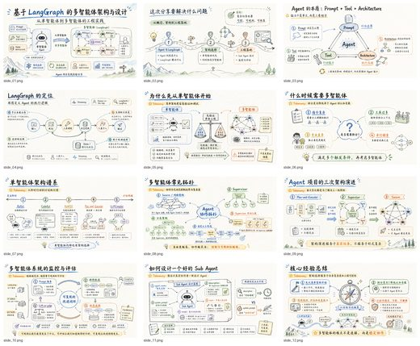
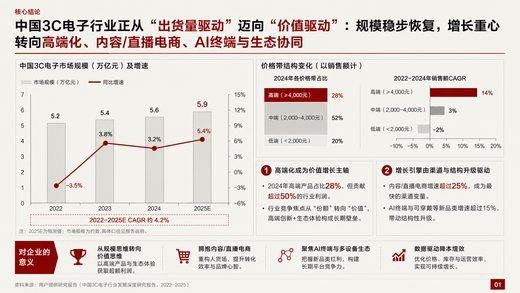

# Awesome Codex Skills

[English](README.md)

**专为 OpenAI Codex 做的开源 skill、插件和工作流**:单个 skill、skill 合集、插件与 MCP、子 agent 工作流、跨 agent 桥接,以及 Codex 自身的周边工具。共 208 个仓库,每个都由 [Agent Skills Hub (agentskillshub.top)](https://agentskillshub.top?utm_source=github&utm_medium=awesome-list) 读过 README 并做了安全评级。

带类型筛选的在线页面:**[https://agentskillshub.top/best/codex-skills/](https://agentskillshub.top/best/codex-skills/?utm_source=github&utm_medium=awesome-list)** · 每 8 小时刷新

## 到底装哪个

我们实跑了其中 12 个(12 个出了结果),结论如下。[完整实测结果](#tested)在下面。

- 🥇 **做 PPT: [codex-ppt-skill](https://github.com/ningzimu/codex-ppt-skill)**  
  在 Codex 里每一次都被打开，哪怕旁边装了 500 个 skill、描述被去掉（两个 agent 合计 18 次中 17 次）：名字本身就说明了用途。它还接走了本该给另一个 PPT skill 的请求，所以 PPT skill 装一个就够，别装好几个。
- 🥈 **把图片版幻灯片变成可编辑: [image-to-editable-ppt-skill](https://github.com/ningzimu/image-to-editable-ppt-skill)**  
  18 次全中，而且和上面那个做的不是一件事，两者不会互相抢。
- 🥉 **让 Codex 自己保持顺畅: [keep-codex-fast](https://github.com/vibeforge1111/keep-codex-fast)**  
  18 次全中。是一个维护用的 skill：先出只读报告，改动前先备份。

**单独用没问题，装多了就找不到（Codex 旁边再装 500 个时）:** CyberPPT (3 次全没中：请求都被 codex-ppt 接走); codex-startup-pressure-test-skill (3 次全没中，另外三个名字排在字母表后面的 skill 也一样).

不管选哪个：在 Codex 里别装太多 skill。装到 512 个时它去掉了所有描述、还隐藏了 134 个 skill，36 次里只有 17 次打开了正确的 skill；装到 112 个以内时是 35 或 36 次。

*排名规则：按「正确的 skill 被打开的次数」排，每个 skill 共 18 次（3 条请求 × 3 档拥挤度 × 2 个 agent），再看 GitHub 星数。这量的是 agent 找不找得到这个 skill，不是它做出来的东西好不好。每条请求只跑一次；请求是照各 skill 自己的描述写的。*

## 这些 Codex skill 做出来的东西

<table>
<tr>
<td align="center" valign="top" width="33%"><b>📚 合集</b> 18 个仓库  一个仓库里的多个 Codex skill 或插件。 <a href="#type-collection"><b>查看列表 →</b></a></td>
<td align="center" valign="top" width="33%"><b>🧩 单个 Skill</b> 100 个仓库   针对一件具体事情的单个 skill 或一小组 skill。 <a href="#type-skill"><b>查看列表 →</b></a></td>
<td align="center" valign="top" width="33%"><b>🔌 插件与 MCP</b> 58 个仓库  给 Codex 增加新能力的插件、扩展和 MCP 服务。 <a href="#type-plugin"><b>查看列表 →</b></a></td>
</tr>
<tr>
<td align="center" valign="top" width="33%"><b>🗺 工作流与子 Agent</b> 13 个仓库  子 agent、规划和长任务工作流。 <a href="#type-workflow"><b>查看列表 →</b></a></td>
<td align="center" valign="top" width="33%"><b>🌉 跨 Agent 桥接</b> 9 个仓库  把 Codex 和 Claude Code、Gemini CLI、Cursor 等连起来。 <a href="#type-bridge"><b>查看列表 →</b></a></td>
<td align="center" valign="top" width="33%"><b>🛠 周边工具</b> 10 个仓库  Codex 的配置、用量统计、会话管理、安装器和界面。 <a href="#type-tooling"><b>查看列表 →</b></a></td>
</tr>
</table>

## 目录

- [🧪 端到端实测](#tested)
- [📚 合集](#type-collection) (18)
- [🧩 单个 Skill](#type-skill) (100)
- [🔌 插件与 MCP](#type-plugin) (58)
- [🗺 工作流与子 Agent](#type-workflow) (13)
- [🌉 跨 Agent 桥接](#type-bridge) (9)
- [🛠 周边工具](#type-tooling) (10)

## 什么样的仓库能上榜

1. 它是为 OpenAI Codex 做的:Codex 是它的主要目标或一等公民,而不是顺带支持的众多 agent 之一。
2. 它是能安装或运行的软件,不是链接合集或空仓库。
3. 它有 README。没有 README 就没法评级。
4. 50 星及以上只看是否切题;50 星以下还要过 README 质量线(展示效果、一条命令上手、说清产出、文档完整),并且至少 5 星。

这些问题由决策模型逐个读 README 回答,不是人工挑选。卡在线上的仓库可能判到任一边,归错了请提 issue。

## 🧪 端到端实测

2026-10-11 我们在用完即删的沙箱里把其中 12 个 skill 一起装上，给每个 agent 发 36 条应该触发其中某个 skill 的请求（每个 skill 三条：直说、不用 skill 自己的词来描述、换一种语言），另加 6 条不该触发任何 skill 的请求。一旦有 skill 被打开就停止，所以量的是 agent 会去用哪个 skill，不是 skill 之后做出了什么。然后在这 12 个旁边再装 100 个、500 个别的真实 skill，重发同样的请求。Codex 用 gpt-6-astra；Claude Code 加载同样的 SKILL.md 格式，用 Claude Opus 5.5。

**发现:** 只装这 12 个时，两个 agent 都是 36 次里 36 次打开了正确的 skill；任何一档都没有为无关请求打开 skill。再装 100 个，各 35 次。再装 500 个，Claude Code 仍有 35/36，Codex 是 17/36：它自己报告去掉了所有 skill 的描述，并有 134 个 skill 没列进列表。有 4 个测试 skill 再也没被打开过，还有一个 PPT skill 把本该给另一个的请求全接走了。

| # | Skill | ★ | 打开正确 skill（共 18 次） | Codex，装 12 个 | Codex，再装 100 个 | Codex，再装 500 个 | Claude Code，再装 500 个 |  |
|---|---|---|---|---|---|---|---|---|
| 1 | [image-to-editable-ppt-skill](https://github.com/ningzimu/image-to-editable-ppt-skill) | 2,860 | 18/18 | 3/3 | 3/3 | 3/3 | 3/3 | [证据](https://agentskillshub.top/best-runs/codex/ningzimu__image-to-editable-ppt-skill.html) |
| 2 | [keep-codex-fast](https://github.com/vibeforge1111/keep-codex-fast) | 1,530 | 18/18 | 3/3 | 3/3 | 3/3 | 3/3 | [证据](https://agentskillshub.top/best-runs/codex/vibeforge1111__keep-codex-fast.html) |
| 3 | [lanshu-animated-architecture-diagram](https://github.com/cclank/lanshu-animated-architecture-diagram) | 947 | 18/18 | 3/3 | 3/3 | 3/3 | 3/3 | [证据](https://agentskillshub.top/best-runs/codex/cclank__lanshu-animated-architecture-diagram.html) |
| 4 | [ian-xiaohei-illustrations](https://github.com/helloianneo/ian-xiaohei-illustrations) | 12,068 | 17/18 | 3/3 | 3/3 | 2/3 | 3/3 | [证据](https://agentskillshub.top/best-runs/codex/helloianneo__ian-xiaohei-illustrations.html) |
| 5 | [codex-ppt-skill](https://github.com/ningzimu/codex-ppt-skill) | 6,661 | 17/18 | 3/3 | 3/3 | 3/3 | 2/3 | [证据](https://agentskillshub.top/best-runs/codex/ningzimu__codex-ppt-skill.html) |
| 6 | [codex-first-customer-finder-skill](https://github.com/Kappaemme-git/codex-first-customer-finder-skill) | 1,047 | 17/18 | 3/3 | 3/3 | 2/3 | 3/3 | [证据](https://agentskillshub.top/best-runs/codex/Kappaemme-git__codex-first-customer-finder-skill.html) |
| 7 | [CyberPPT](https://github.com/crazyykhllc-bit/CyberPPT) | 1,770 | 15/18 | 3/3 | 3/3 | 0/3 | 3/3 | [证据](https://agentskillshub.top/best-runs/codex/crazyykhllc-bit__CyberPPT.html) |
| 8 | [codex-startup-pressure-test-skill](https://github.com/Kappaemme-git/codex-startup-pressure-test-skill) | 990 | 15/18 | 3/3 | 3/3 | 0/3 | 3/3 | [证据](https://agentskillshub.top/best-runs/codex/Kappaemme-git__codex-startup-pressure-test-skill.html) |
| 9 | [qiaomu-goal-meta-skill](https://github.com/joeseesun/qiaomu-goal-meta-skill) | 900 | 15/18 | 3/3 | 3/3 | 0/3 | 3/3 | [证据](https://agentskillshub.top/best-runs/codex/joeseesun__qiaomu-goal-meta-skill.html) |
| 10 | [travel-photo-abstraction](https://github.com/Evianis/travel-photo-abstraction) | 749 | 15/18 | 3/3 | 3/3 | 0/3 | 3/3 | [证据](https://agentskillshub.top/best-runs/codex/Evianis__travel-photo-abstraction.html) |
| 11 | [codex-visio-paper-figure-skill](https://github.com/pengjunchi0/codex-visio-paper-figure-skill) | 680 | 15/18 | 3/3 | 3/3 | 0/3 | 3/3 | [证据](https://agentskillshub.top/best-runs/codex/pengjunchi0__codex-visio-paper-figure-skill.html) |
| 12 | [codex-complexity-optimizer](https://github.com/Kappaemme-git/codex-complexity-optimizer) | 913 | 14/18 | 3/3 | 2/3 | 1/3 | 3/3 | [证据](https://agentskillshub.top/best-runs/codex/Kappaemme-git__codex-complexity-optimizer.html) |

[全部结果、提示词和脚本](https://github.com/zhuyansen/agent-skills-hub/blob/main/ops/codex-runs/) · [https://agentskillshub.top/best/codex-skills/#test-results](https://agentskillshub.top/best/codex-skills/?utm_source=github&utm_medium=awesome-list#test-results)

## 📚 合集

[在在线页面打开这一类,按星数排序 →](https://agentskillshub.top/best/codex-skills/?utm_source=github&utm_medium=awesome-list#type-collection)

| 仓库 | 星数 | 做什么 | 安全评级 |
|---|---:|---|---|
| [AgriciDaniel/codex-seo](https://github.com/AgriciDaniel/codex-seo) | 854 | SEO skill：26流程、24 TOML agent；集成DataForSEO等，含GEO/AEO、CWV、schema、backlinks、local/… | [SAFE](https://agentskillshub.top/skill/AgriciDaniel/codex-seo/?utm_source=github&utm_medium=awesome-list) |
| [xiao24bei/xiaobei-skill](https://github.com/xiao24bei/xiaobei-skill) | 599 | Codex Skills 合集：Image to VBA、Academic Paper to PPT 等 AI 科研工作流。 | [SAFE](https://agentskillshub.top/skill/xiao24bei/xiaobei-skill/?utm_source=github&utm_medium=awesome-list) |
| [CloudWave818/ieee-skills](https://github.com/CloudWave818/ieee-skills) | 409 | 面向 IEEE 论文写作、润色、审稿、实验、图表、LaTeX、引用与阅读的 Codex skills。 | [SAFE](https://agentskillshub.top/skill/CloudWave818/ieee-skills/?utm_source=github&utm_medium=awesome-list) |
| [haorantang97/LabArt](https://github.com/haorantang97/LabArt) | 291 | Codex 原创视觉与艺术创作 skill 市集 | [SAFE](https://agentskillshub.top/skill/haorantang97/LabArt/?utm_source=github&utm_medium=awesome-list) |
| [XliuXjianX/blender-production-skills](https://github.com/XliuXjianX/blender-production-skills) | 268 | Codex 的 Blender 技能套件，涵盖建模、几何节点、模拟、材质、拓扑、场景验证和参考图重建工作流。 | [SAFE](https://agentskillshub.top/skill/XliuXjianX/blender-production-skills/?utm_source=github&utm_medium=awesome-list) |
| [feiskyer/codex-settings](https://github.com/feiskyer/codex-settings) | 247 | 为 Codex CLI 精选 skills、profiles 和配置模板，支持多模型、深度研究、图像生成和浏览器自动化。 | [SAFE](https://agentskillshub.top/skill/feiskyer/codex-settings/?utm_source=github&utm_medium=awesome-list) |
| [yokel1121/muyang-illustration-skills](https://github.com/yokel1121/muyang-illustration-skills) | 209 | Codex 的25种固定插画风格：9个 skill、提示词配方和视觉参考 | [SAFE](https://agentskillshub.top/skill/yokel1121/muyang-illustration-skills/?utm_source=github&utm_medium=awesome-list) |
| [Sven-LI-sankyuu/presentation-skills](https://github.com/Sven-LI-sankyuu/presentation-skills) | 176 | Codex CLI 的演示工作流 skill 集合，涵盖可编辑 PPT 图示协作和网页 demo 视频合成。 | [SAFE](https://agentskillshub.top/skill/Sven-LI-sankyuu/presentation-skills/?utm_source=github&utm_medium=awesome-list) |
| [moonlarry/codex-paper-skills](https://github.com/moonlarry/codex-paper-skills) | 176 | Codex运行规范及论文写作所用的多个skill | [SAFE](https://agentskillshub.top/skill/moonlarry/codex-paper-skills/?utm_source=github&utm_medium=awesome-list) |
| [Vieeeeeee/wibi-style](https://github.com/Vieeeeeee/wibi-style) | 171 | 适用于 Codex 的 36 个可安装视觉设计 skill，含可复用 Python 工具和版本化软件包。将照片转为艺术作品。在线体验：style.abdc.o… | [SAFE](https://agentskillshub.top/skill/Vieeeeeee/wibi-style/?utm_source=github&utm_medium=awesome-list) |
| [xvchujin/umat-skill](https://github.com/xvchujin/umat-skill) | 148 | 用于本构建模、返回映射、损伤、状态契约、切线审计和分层验证的 Abaqus UMAT Codex skills。 | [SAFE](https://agentskillshub.top/skill/xvchujin/umat-skill/?utm_source=github&utm_medium=awesome-list) |
| [jMerta/codex-skills](https://github.com/jMerta/codex-skills) | 131 | Codex CLI 技能目录 | [SAFE](https://agentskillshub.top/skill/jMerta/codex-skills/?utm_source=github&utm_medium=awesome-list) |
| [fivetaku/gptaku-plugins-codex](https://github.com/fivetaku/gptaku-plugins-codex) | 128 | Codex 原生 GPTaku 插件市场 | [SAFE](https://agentskillshub.top/skill/fivetaku/gptaku-plugins-codex/?utm_source=github&utm_medium=awesome-list) |
| [ReJeCtAll/ExpertTeam-Codex](https://github.com/ReJeCtAll/ExpertTeam-Codex) | 113 | 可安装到 ~/.codex，适用于 Codex CLI / Codex App 的 Skill 配置，含 3 个专家团、3 个单专家和 1 个总路由入口。 | [SAFE](https://agentskillshub.top/skill/ReJeCtAll/ExpertTeam-Codex/?utm_source=github&utm_medium=awesome-list) |
| [grp06/useful-codex-skills](https://github.com/grp06/useful-codex-skills) | 78 | 用于目标、规划、执行和代码理解的Codex skills：grill-me、grillcraft、execplan-create、execplan-impro… | [SAFE](https://agentskillshub.top/skill/grp06/useful-codex-skills/?utm_source=github&utm_medium=awesome-list) |
| [sechiro/VRCUdonSkills-for-Codex](https://github.com/sechiro/VRCUdonSkills-for-Codex) | 59 | VRCUdonSkills-for-Codex | [SAFE](https://agentskillshub.top/skill/sechiro/VRCUdonSkills-for-Codex/?utm_source=github&utm_medium=awesome-list) |
| [Immortalqx/my_codex_skills](https://github.com/Immortalqx/my_codex_skills) | 55 | 此仓库收集我个人用于可复用研究工作流的 Codex skills。 | [SAFE](https://agentskillshub.top/skill/Immortalqx/my_codex_skills/?utm_source=github&utm_medium=awesome-list) |
| [haibarazz/awesome-codex-research](https://github.com/haibarazz/awesome-codex-research) | 4 | Codex 科研工作流仓库，包含独立 Skill 和 Codex Plugin，涵盖 AutoDL 远程控制、实验管理、意图对齐和论文润色。 | [SAFE](https://agentskillshub.top/skill/haibarazz/awesome-codex-research/?utm_source=github&utm_medium=awesome-list) |

## 🧩 单个 Skill

[在在线页面打开这一类,按星数排序 →](https://agentskillshub.top/best/codex-skills/?utm_source=github&utm_medium=awesome-list#type-skill)

<table><tr>
<td align="center" valign="top"> <a href="https://github.com/ningzimu/codex-ppt-skill">ningzimu/codex-ppt-skill</a></td>
<td align="center" valign="top"> <a href="https://github.com/ningzimu/image-to-editable-ppt-skill">ningzimu/image-to-editable-ppt-skill</a></td>
<td align="center" valign="top"> <a href="https://github.com/crazyykhllc-bit/CyberPPT">crazyykhllc-bit/CyberPPT</a></td>
</tr></table>

| 仓库 | 星数 | 做什么 | 安全评级 |
|---|---:|---|---|
| [helloianneo/ian-xiaohei-illustrations](https://github.com/helloianneo/ian-xiaohei-illustrations) | 12.8k | 中文小黑怪诞正文配图生成 Skill，16:9白底手绘，少量红橙蓝批注，Codex Skill | [SAFE](https://agentskillshub.top/skill/helloianneo/ian-xiaohei-illustrations/?utm_source=github&utm_medium=awesome-list) |
| [ningzimu/codex-ppt-skill](https://github.com/ningzimu/codex-ppt-skill) | 7.3k | GPT-Image-2 图片型 PowerPoint 演示文稿生成 skill，适用于 Codex 等 agent | [SAFE](https://agentskillshub.top/skill/ningzimu/codex-ppt-skill/?utm_source=github&utm_medium=awesome-list) |
| [ningzimu/image-to-editable-ppt-skill](https://github.com/ningzimu/image-to-editable-ppt-skill) | 3.1k | 用于将幻灯片图像、PDF 和基于图像的 PPTX 文件转换为可编辑 PowerPoint 演示文稿的 Codex skill。 | [SAFE](https://agentskillshub.top/skill/ningzimu/image-to-editable-ppt-skill/?utm_source=github&utm_medium=awesome-list) |
| [crazyykhllc-bit/CyberPPT](https://github.com/crazyykhllc-bit/CyberPPT) | 1.8k | 生成高密度、可编辑咨询风格 PowerPoint 的 Codex Skill，支持 SCR 叙事、风格确认和 PPTX 质量检查。 | [SAFE](https://agentskillshub.top/skill/crazyykhllc-bit/CyberPPT/?utm_source=github&utm_medium=awesome-list) |
| [vibeforge1111/keep-codex-fast](https://github.com/vibeforge1111/keep-codex-fast) | 1.6k | 以备份为先的 Codex skill，让本地 Codex 状态保持快速、整洁且可恢复。 | [SAFE](https://agentskillshub.top/skill/vibeforge1111/keep-codex-fast/?utm_source=github&utm_medium=awesome-list) |
| [Kappaemme-git/codex-first-customer-finder-skill](https://github.com/Kappaemme-git/codex-first-customer-finder-skill) | 1.1k | 根据近期公开信号寻找有证据支持的潜在首批客户的 Codex skill。 | [SAFE](https://agentskillshub.top/skill/Kappaemme-git/codex-first-customer-finder-skill/?utm_source=github&utm_medium=awesome-list) |
| [pengjunchi0/codex-visio-paper-figure-skill](https://github.com/pengjunchi0/codex-visio-paper-figure-skill) | 1.1k | 科研绘图skill、论文绘图skill：将图片转为可编辑格式，便于调整细节 | [SAFE](https://agentskillshub.top/skill/pengjunchi0/codex-visio-paper-figure-skill/?utm_source=github&utm_medium=awesome-list) |
| [cclank/lanshu-animated-architecture-diagram](https://github.com/cclank/lanshu-animated-architecture-diagram) | 1.0k | 手绘风动画架构图 Codex skill | [SAFE](https://agentskillshub.top/skill/cclank/lanshu-animated-architecture-diagram/?utm_source=github&utm_medium=awesome-list) |
| [Kappaemme-git/codex-startup-pressure-test-skill](https://github.com/Kappaemme-git/codex-startup-pressure-test-skill) | 992 | 用 Codex 严格检验创业想法，输出诊断、缺陷、竞争分析和两周 MVP 方向。 | [SAFE](https://agentskillshub.top/skill/Kappaemme-git/codex-startup-pressure-test-skill/?utm_source=github&utm_medium=awesome-list) |
| [Kappaemme-git/codex-complexity-optimizer](https://github.com/Kappaemme-git/codex-complexity-optimizer) | 914 | 用于安全分析代码库复杂度并生成性能优化报告的 Codex skill | [SAFE](https://agentskillshub.top/skill/Kappaemme-git/codex-complexity-optimizer/?utm_source=github&utm_medium=awesome-list) |
| [joeseesun/qiaomu-goal-meta-skill](https://github.com/joeseesun/qiaomu-goal-meta-skill) | 899 | 将模糊或复杂的 Codex 任务转为明确的 /goal 命令，包含结果、验证、约束、边界、迭代策略和完成证据 | [SAFE](https://agentskillshub.top/skill/joeseesun/qiaomu-goal-meta-skill/?utm_source=github&utm_medium=awesome-list) |
| [Evianis/travel-photo-abstraction](https://github.com/Evianis/travel-photo-abstraction) | 788 | 源码可用的 Codex skill，用于将照片提炼为简约的编辑式抽象。 | [SAFE](https://agentskillshub.top/skill/Evianis/travel-photo-abstraction/?utm_source=github&utm_medium=awesome-list) |
| [LunarXuan/image-prompt-reverse](https://github.com/LunarXuan/image-prompt-reverse) | 645 | 适用于 Codex 的高保真 AI 图像提示词逆向工程 skill | [SAFE](https://agentskillshub.top/skill/LunarXuan/image-prompt-reverse/?utm_source=github&utm_medium=awesome-list) |
| [liyue-aigc/xianxia-visual-director](https://github.com/liyue-aigc/xianxia-visual-director) | 584 | Codex skill：电影感东方仙侠静帧、天界和天空巨型结构。 | [SAFE](https://agentskillshub.top/skill/liyue-aigc/xianxia-visual-director/?utm_source=github&utm_medium=awesome-list) |
| [HaichaoLihc/create-photo-flipbook-ui](https://github.com/HaichaoLihc/create-photo-flipbook-ui) | 555 | 用于使用用户提供的图片构建响应式 3D 照片翻页网站的 Codex skill | [SAFE](https://agentskillshub.top/skill/HaichaoLihc/create-photo-flipbook-ui/?utm_source=github&utm_medium=awesome-list) |
| [helloianneo/ian-xiaohei-scenes](https://github.com/helloianneo/ian-xiaohei-scenes) | 541 | Xiaohei 2.0 Codex skill：用于中文实物文章插图和长图故事图片 | [SAFE](https://agentskillshub.top/skill/helloianneo/ian-xiaohei-scenes/?utm_source=github&utm_medium=awesome-list) |
| [AAASS554/codex-academic-paper-skills](https://github.com/AAASS554/codex-academic-paper-skills) | 540 | Codex 学术论文 skills，用于软件工程论文规划和修改 | [SAFE](https://agentskillshub.top/skill/AAASS554/codex-academic-paper-skills/?utm_source=github&utm_medium=awesome-list) |
| [TaiT-tt/tait-crt-interface-skill](https://github.com/TaiT-tt/tait-crt-interface-skill) | 534 | TaiT-CRT-Interface-Skill 是 Codex 图像生成 skill，可将人像、照片或文字描述转换为早期 CRT 计算机界面风格的复古插画。 | [SAFE](https://agentskillshub.top/skill/TaiT-tt/tait-crt-interface-skill/?utm_source=github&utm_medium=awesome-list) |
| [Pikapika260214/rw-consulting-ppt](https://github.com/Pikapika260214/rw-consulting-ppt) | 500 | 带可编辑选项的咨询演示文稿 skill，适用于 Codex | [SAFE](https://agentskillshub.top/skill/Pikapika260214/rw-consulting-ppt/?utm_source=github&utm_medium=awesome-list) |
| [wnby/photo-relic-editorial](https://github.com/wnby/photo-relic-editorial) | 438 | 将真实照片转化为 Photo Relic 艺术作品的 Codex skill：真实照片配静谧的纸质记忆印件。 | [SAFE](https://agentskillshub.top/skill/wnby/photo-relic-editorial/?utm_source=github&utm_medium=awesome-list) |
| [hi-nikola/hand-drawn-explainer-video-nikola](https://github.com/hi-nikola/hand-drawn-explainer-video-nikola) | 427 | 中文手绘知识讲解视频 Codex Skill：逐笔故事、双语义岛、让怪诞小黑动起来与程序动画 | [SAFE](https://agentskillshub.top/skill/hi-nikola/hand-drawn-explainer-video-nikola/?utm_source=github&utm_medium=awesome-list) |
| [Jane-xiaoer/paper-collage-ad-codex](https://github.com/Jane-xiaoer/paper-collage-ad-codex) | 425 | 用于剪纸拼贴广告制作的 Codex skill，支持本地 IndexTTS-2 声音克隆、动画、音频和 MP4 质检 | [SAFE](https://agentskillshub.top/skill/Jane-xiaoer/paper-collage-ad-codex/?utm_source=github&utm_medium=awesome-list) |
| [yuzhworkhard-wq/image-to-code](https://github.com/yuzhworkhard-wq/image-to-code) | 352 | 用于 750px 图像转代码重建和透明 PNG 切片的 Codex skill | [SAFE](https://agentskillshub.top/skill/yuzhworkhard-wq/image-to-code/?utm_source=github&utm_medium=awesome-list) |
| [zimo-xiao-zheng/godot-ui-integration](https://github.com/zimo-xiao-zheng/godot-ui-integration) | 344 | 用于根据已批准设计构建 Godot UI 的 Codex skill，提供编辑器可见场景和运行时视觉一致性检查。 | [SAFE](https://agentskillshub.top/skill/zimo-xiao-zheng/godot-ui-integration/?utm_source=github&utm_medium=awesome-list) |
| [laok775/jobflow-for-codex](https://github.com/laok775/jobflow-for-codex) | 305 | Codex 的 JobFlow：本地求职工作流插件 | [SAFE](https://agentskillshub.top/skill/laok775/jobflow-for-codex/?utm_source=github&utm_medium=awesome-list) |
| [Brandon030722/ark-ui-skill](https://github.com/Brandon030722/ark-ui-skill) | 287 | 基于证据的 Codex skill，涵盖五类 Ark 相关 UI 和四种应用深度 | [SAFE](https://agentskillshub.top/skill/Brandon030722/ark-ui-skill/?utm_source=github&utm_medium=awesome-list) |
| [liyue-aigc/xianxia-cinematic-video-director](https://github.com/liyue-aigc/xianxia-cinematic-video-director) | 271 | 用于东方仙侠题材分镜、运镜和视频连贯性的 Codex Skill | [SAFE](https://agentskillshub.top/skill/liyue-aigc/xianxia-cinematic-video-director/?utm_source=github&utm_medium=awesome-list) |
| [LerSent001/holo-card](https://github.com/LerSent001/holo-card) | 270 | 支持视差和轮廓发光的分层全息卡片 Codex skill，可选 API 工作流 | [SAFE](https://agentskillshub.top/skill/LerSent001/holo-card/?utm_source=github&utm_medium=awesome-list) |
| [Lucaswangzcx/literature-downloader-skill](https://github.com/Lucaswangzcx/literature-downloader-skill) | 257 | 用于学术文献检索、合法全文下载、可读报告和学生友好论文列表的中文 Codex skill。 | [SAFE](https://agentskillshub.top/skill/Lucaswangzcx/literature-downloader-skill/?utm_source=github&utm_medium=awesome-list) |
| [0Antique/Auto-Visio-Helper](https://github.com/0Antique/Auto-Visio-Helper) | 251 | 帮助 Codex 操作本地 Visio 生成可编辑科研绘图的 skill，支持自然语言转图、图片复现、JVSDX 生成、预览和导出。 | [SAFE](https://agentskillshub.top/skill/0Antique/Auto-Visio-Helper/?utm_source=github&utm_medium=awesome-list) |
| [yantoumu/adsense-site-auditor-skill](https://github.com/yantoumu/adsense-site-auditor-skill) | 245 | 用于全面审计 Google AdSense 申请准备情况的 Codex skill | [SAFE](https://agentskillshub.top/skill/yantoumu/adsense-site-auditor-skill/?utm_source=github&utm_medium=awesome-list) |
| [AJbeckliy/detail-flow](https://github.com/AJbeckliy/detail-flow) | 229 | 用于规划、生成、审核和交付电商产品详情页的可复用 Codex skill。 | [SAFE](https://agentskillshub.top/skill/AJbeckliy/detail-flow/?utm_source=github&utm_medium=awesome-list) |
| [Ronnie2025/codex-ppt-skill](https://github.com/Ronnie2025/codex-ppt-skill) | 222 | 中文 toB 商业汇报的 Codex PPT 生图、元素重组与 SVG 拆解工作流 | [SAFE](https://agentskillshub.top/skill/Ronnie2025/codex-ppt-skill/?utm_source=github&utm_medium=awesome-list) |
| [michaelpersonal/goal-forge](https://github.com/michaelpersonal/goal-forge) | 213 | Codex skill：将粗略编码想法转化为 SPEC.md、GOAL.md 和 /goal-ready 合约。 | [SAFE](https://agentskillshub.top/skill/michaelpersonal/goal-forge/?utm_source=github&utm_medium=awesome-list) |
| [wwe-dog/ppt-image2-editable-rebuild](https://github.com/wwe-dog/ppt-image2-editable-rebuild) | 201 | 基于截图/参考图重建可编辑PPT的Codex skill：用image2/imagegen生成参考图，以局部截图保留视觉资产并重建可编辑元素。 | [SAFE](https://agentskillshub.top/skill/wwe-dog/ppt-image2-editable-rebuild/?utm_source=github&utm_medium=awesome-list) |
| [izscc/cc2image](https://github.com/izscc/cc2image) | 189 | Codex 中文内容交互式生图 Skill：认知锚点拆图，49套内容风格、8套Logo/图标模式，支持封面、配图、系列主视觉和批量提示词。 | [SAFE](https://agentskillshub.top/skill/izscc/cc2image/?utm_source=github&utm_medium=awesome-list) |
| [weeelin98/ResumeDom](https://github.com/weeelin98/ResumeDom) | 188 | 以证据为先的 Codex skill，用于审核、改写、定制和生成适合 ATS 读取的美国科技简历，面向计算机科学实习生和应届毕业生。 | [SAFE](https://agentskillshub.top/skill/weeelin98/ResumeDom/?utm_source=github&utm_medium=awesome-list) |
| [tao943/build-resume-portfolio-site](https://github.com/tao943/build-resume-portfolio-site) | 186 | 用于构建分阶段 React + Vite 简历和作品集网站的 Codex skill | [SAFE](https://agentskillshub.top/skill/tao943/build-resume-portfolio-site/?utm_source=github&utm_medium=awesome-list) |
| [Cuimao777/eterna-image2image-skill](https://github.com/Cuimao777/eterna-image2image-skill) | 185 | 实验性双语 Codex skill，用于受 ETERNA 启发的 image2image 电影感色彩与构图。 | [SAFE](https://agentskillshub.top/skill/Cuimao777/eterna-image2image-skill/?utm_source=github&utm_medium=awesome-list) |
| [xdmlxdml/beamer2pptx](https://github.com/xdmlxdml/beamer2pptx) | 172 | 将 Beamer PDF 转换为含原生公式的可编辑 PowerPoint 演示文稿的 Codex Skill。 | [SAFE](https://agentskillshub.top/skill/xdmlxdml/beamer2pptx/?utm_source=github&utm_medium=awesome-list) |
| [carolinaaafy/travel-memory-card-duo](https://github.com/carolinaaafy/travel-memory-card-duo) | 170 | Codex skill：输出成品旅行纪念卡及含相同六种图案的透明背景 PNG 贴纸图。 | [SAFE](https://agentskillshub.top/skill/carolinaaafy/travel-memory-card-duo/?utm_source=github&utm_medium=awesome-list) |
| [1838904818/audit-repo](https://github.com/1838904818/audit-repo) | 155 | 用于基于证据审计仓库健康状况的 Codex skill | [SAFE](https://agentskillshub.top/skill/1838904818/audit-repo/?utm_source=github&utm_medium=awesome-list) |
| [zhbi98/pcb-layout-design](https://github.com/zhbi98/pcb-layout-design) | 149 | Codex PCB Layout Skill：GPT-6 Astra/Sol × KiCad10 的 PCB 自动布线，涵盖通用规则、DDR/USB/CAN… | [SAFE](https://agentskillshub.top/skill/zhbi98/pcb-layout-design/?utm_source=github&utm_medium=awesome-list) |
| [chenzixin1/watchless](https://github.com/chenzixin1/watchless) | 145 | 将视频转为完整关键帧驱动视觉文档的 Codex skill | [SAFE](https://agentskillshub.top/skill/chenzixin1/watchless/?utm_source=github&utm_medium=awesome-list) |
| [knight6669/knight-imagetopptx-skill](https://github.com/knight6669/knight-imagetopptx-skill) | 136 | 将语义幻灯片图像转换为可编辑 PPTX 的 Codex skill | [SAFE](https://agentskillshub.top/skill/knight6669/knight-imagetopptx-skill/?utm_source=github&utm_medium=awesome-list) |
| [dacnay816y62-hub/character-casting-studio-skill](https://github.com/dacnay816y62-hub/character-casting-studio-skill) | 133 | 基于材质参考的照片级写实角色选角 skill，适用于 Codex | [SAFE](https://agentskillshub.top/skill/dacnay816y62-hub/character-casting-studio-skill/?utm_source=github&utm_medium=awesome-list) |
| [GODGOD126/self-improving-for-codex](https://github.com/GODGOD126/self-improving-for-codex) | 130 | 基于 AGENTS.md、记忆和夜间复盘自动化的 Codex 原生自我改进 skill。 | [SAFE](https://agentskillshub.top/skill/GODGOD126/self-improving-for-codex/?utm_source=github&utm_medium=awesome-list) |
| [darksider-9/master-thesis-studio-skill](https://github.com/darksider-9/master-thesis-studio-skill) | 129 | 东南大学中文硕士论文写作与 Word 自动生成 Codex Skill | [SAFE](https://agentskillshub.top/skill/darksider-9/master-thesis-studio-skill/?utm_source=github&utm_medium=awesome-list) |
| [FanPUYen/deep-reading-coach](https://github.com/FanPUYen/deep-reading-coach) | 120 | 用于深度阅读书籍和 PDF 的 Codex skill | [SAFE](https://agentskillshub.top/skill/FanPUYen/deep-reading-coach/?utm_source=github&utm_medium=awesome-list) |
| [fangyuanopus/literature-report-ppt-builder](https://github.com/fangyuanopus/literature-report-ppt-builder) | 120 | 用于生成学术文献报告 PPT 的开源 Codex skill | [SAFE](https://agentskillshub.top/skill/fangyuanopus/literature-report-ppt-builder/?utm_source=github&utm_medium=awesome-list) |
| [zyz254009-crypto/script-to-shootable-storyboard](https://github.com/zyz254009-crypto/script-to-shootable-storyboard) | 119 | 剧本转可拍分镜 Skill，使用 Codex 开发，支持 Seedance、真人/混合制作与二次开发。 | [SAFE](https://agentskillshub.top/skill/zyz254009-crypto/script-to-shootable-storyboard/?utm_source=github&utm_medium=awesome-list) |
| [DoraRabbitYan/personal-ip-image-pack](https://github.com/DoraRabbitYan/personal-ip-image-pack) | 118 | 用于生成可复用个人IP卡通图片包的 Codex skill。 | [SAFE](https://agentskillshub.top/skill/DoraRabbitYan/personal-ip-image-pack/?utm_source=github&utm_medium=awesome-list) |
| [lokikill123/codex-token-skills](https://github.com/lokikill123/codex-token-skills) | 118 | 在 Codex CLI 中降低 DeepSeek V4 Pro 的 token 成本 60-80%，使用 token-saver、memory skills… | [SAFE](https://agentskillshub.top/skill/lokikill123/codex-token-skills/?utm_source=github&utm_medium=awesome-list) |
| [superpilot69/pdf-trad-to-simp-preserve-layout-kit](https://github.com/superpilot69/pdf-trad-to-simp-preserve-layout-kit) | 118 | PDF 繁体转简体转换工具包，含保留版式脚本、Codex skill 及示例源文件和输出 PDF。 | [SAFE](https://agentskillshub.top/skill/superpilot69/pdf-trad-to-simp-preserve-layout-kit/?utm_source=github&utm_medium=awesome-list) |
| [jaxxchen003/book-video-factory](https://github.com/jaxxchen003/book-video-factory) | 110 | 可移植的 Codex skill，用于可审计、注重版权的中文书评短视频工作流 | [SAFE](https://agentskillshub.top/skill/jaxxchen003/book-video-factory/?utm_source=github&utm_medium=awesome-list) |
| [ExplosiveCoderflome/ani-book-skill](https://github.com/ExplosiveCoderflome/ani-book-skill) | 107 | 面向 Codex 的长篇中文小说创作 Skill：用可恢复的 Markdown 工作流管理灵感、规划、写作、审校和连续性。 | [SAFE](https://agentskillshub.top/skill/ExplosiveCoderflome/ani-book-skill/?utm_source=github&utm_medium=awesome-list) |
| [uigiuf/codex-visio-replica-workflow](https://github.com/uigiuf/codex-visio-replica-workflow) | 107 | 用于将参考图表重建为可编辑 Microsoft Visio 文件的 Codex skill | [SAFE](https://agentskillshub.top/skill/uigiuf/codex-visio-replica-workflow/?utm_source=github&utm_medium=awesome-list) |
| [caofan85-lab/research-paper-daily-push](https://github.com/caofan85-lab/research-paper-daily-push) | 103 | 可配置的 Codex skill：每日检索、复核证据、评分、中文总结、微信推送、去重和研究记忆。 | [SAFE](https://agentskillshub.top/skill/caofan85-lab/research-paper-daily-push/?utm_source=github&utm_medium=awesome-list) |
| [grp06/goalcraft](https://github.com/grp06/goalcraft) | 102 | 用于编写高质量 /goal 提示词的 Codex skill | [SAFE](https://agentskillshub.top/skill/grp06/goalcraft/?utm_source=github&utm_medium=awesome-list) |
| [lin1111-1/academic-integrity-rewrite](https://github.com/lin1111-1/academic-integrity-rewrite) | 102 | 用于中英文保留证据的学术改写 Codex skill | [SAFE](https://agentskillshub.top/skill/lin1111-1/academic-integrity-rewrite/?utm_source=github&utm_medium=awesome-list) |
| [pmlaowangba-lab/laowangba-pmprototype-skill](https://github.com/pmlaowangba-lab/laowangba-pmprototype-skill) | 102 | 用于产品原型生成的 Codex skill，包含 IA、设计门禁、页面 UI YAML 和 Figma 工作流。 | [SAFE](https://agentskillshub.top/skill/pmlaowangba-lab/laowangba-pmprototype-skill/?utm_source=github&utm_medium=awesome-list) |
| [oil-oil/codex](https://github.com/oil-oil/codex) | 101 | 用于将编码任务委托给 Codex CLI 的 Claude Code skill | [SAFE](https://agentskillshub.top/skill/oil-oil/codex/?utm_source=github&utm_medium=awesome-list) |
| [BIAsia/voxel-icon](https://github.com/BIAsia/voxel-icon) | 100 | Voxel Icon — 30 个 PNG 图标和一个独立 Codex skill，适用于低密度等距体素艺术 | [SAFE](https://agentskillshub.top/skill/BIAsia/voxel-icon/?utm_source=github&utm_medium=awesome-list) |
| [oldred-byte/ec-visual-skill](https://github.com/oldred-byte/ec-visual-skill) | 99 | 基于产品图和参考图制作电商视觉素材的 Codex skill | [SAFE](https://agentskillshub.top/skill/oldred-byte/ec-visual-skill/?utm_source=github&utm_medium=awesome-list) |
| [lisamsung/agent-meme-forge](https://github.com/lisamsung/agent-meme-forge) | 98 | Codex skill将一张图片或文字概念转为适合微信发送的中文表情包。4个关键姿势→16帧，不使用模型绘制文字。 | [SAFE](https://agentskillshub.top/skill/lisamsung/agent-meme-forge/?utm_source=github&utm_medium=awesome-list) |
| [See-Sol-Lab/private-house-code-v2.5](https://github.com/See-Sol-Lab/private-house-code-v2.5) | 95 | 让 Codex 少用 Token、避免复杂度且保持代码质量的约束 Skill | [SAFE](https://agentskillshub.top/skill/See-Sol-Lab/private-house-code-v2.5/?utm_source=github&utm_medium=awesome-list) |
| [LEON-gittech/Skill2Poster](https://github.com/LEON-gittech/Skill2Poster) | 91 | 用于学术海报生成的 Codex skills：通过 AI 设计稿将论文内容转为准确的 A0 HTML/PDF 海报。 | [SAFE](https://agentskillshub.top/skill/LEON-gittech/Skill2Poster/?utm_source=github&utm_medium=awesome-list) |
| [mengke-wang/zh-humanizer-literary](https://github.com/mengke-wang/zh-humanizer-literary) | 90 | 增强 Codex Skill 的中文去 AI 味与文采，让草稿更像人写。 | [SAFE](https://agentskillshub.top/skill/mengke-wang/zh-humanizer-literary/?utm_source=github&utm_medium=awesome-list) |
| [uncle11/xfc-ip-all-png-template](https://github.com/uncle11/xfc-ip-all-png-template) | 90 | 可复用的 Codex skill 模板，用于使用用户定义的 IP 角色和配色制作简线文章插图。 | [SAFE](https://agentskillshub.top/skill/uncle11/xfc-ip-all-png-template/?utm_source=github&utm_medium=awesome-list) |
| [xiaoTN/zelda-style-image-prompt](https://github.com/xiaoTN/zelda-style-image-prompt) | 84 | 用于编写《塞尔达传说》风格图像提示词的 Codex skill | [SAFE](https://agentskillshub.top/skill/xiaoTN/zelda-style-image-prompt/?utm_source=github&utm_medium=awesome-list) |
| [cavoiie/fluent-cfd-skill](https://github.com/cavoiie/fluent-cfd-skill) | 83 | 用于 Ansys Fluent 和 PyFluent CFD 工作流的 Codex skill | [SAFE](https://agentskillshub.top/skill/cavoiie/fluent-cfd-skill/?utm_source=github&utm_medium=awesome-list) |
| [luji12/daily-photo-playground](https://github.com/luji12/daily-photo-playground) | 82 | 将日常照片重构为3:4高饱和情绪化编辑海报的 Codex skill | [SAFE](https://agentskillshub.top/skill/luji12/daily-photo-playground/?utm_source=github&utm_medium=awesome-list) |
| [ACTAshui/sjtu-ppt-template-skill](https://github.com/ACTAshui/sjtu-ppt-template-skill) | 81 | 用于创建可编辑的上海交通大学风格 PowerPoint 演示文稿的 Codex skill | [SAFE](https://agentskillshub.top/skill/ACTAshui/sjtu-ppt-template-skill/?utm_source=github&utm_medium=awesome-list) |
| [sudoHG/codex-reset-credits-skill](https://github.com/sudoHG/codex-reset-credits-skill) | 80 | Codex Skill 和 runbook：查询已存 Codex 重置额度及过期时间，支持安装或免安装一次性查询 | [SAFE](https://agentskillshub.top/skill/sudoHG/codex-reset-credits-skill/?utm_source=github&utm_medium=awesome-list) |
| [CheshireMew/Price-action-analysis](https://github.com/CheshireMew/Price-action-analysis) | 73 | 用于标注价格行为图表分析的 Codex skill | [SAFE](https://agentskillshub.top/skill/CheshireMew/Price-action-analysis/?utm_source=github&utm_medium=awesome-list) |
| [promptwhisper/clone-any-website-skill](https://github.com/promptwhisper/clone-any-website-skill) | 66 | 用于重建公开网站的 Codex skill，构建整洁易维护的项目并进行规范的视觉与交互 QA。 | [SAFE](https://agentskillshub.top/skill/promptwhisper/clone-any-website-skill/?utm_source=github&utm_medium=awesome-list) |
| [Gyratingice-blip/codex-windows-bundled-plugin-repair](https://github.com/Gyratingice-blip/codex-windows-bundled-plugin-repair) | 64 | 修复 Windows 上 Codex Desktop 内置的 Chrome 和 Computer Use 插件。 | [SAFE](https://agentskillshub.top/skill/Gyratingice-blip/codex-windows-bundled-plugin-repair/?utm_source=github&utm_medium=awesome-list) |
| [xiaomaxueshufen/data-analysis](https://github.com/xiaomaxueshufen/data-analysis) | 64 | Excel/CSV 数据分析 Codex skill，支持异动、漏斗、指标、AB 实验、因果、分层、贡献度、比率拆解和行业口径模板 | [SAFE](https://agentskillshub.top/skill/xiaomaxueshufen/data-analysis/?utm_source=github&utm_medium=awesome-list) |
| [XuToWei/Image-To-UI](https://github.com/XuToWei/Image-To-UI) | 63 | Image-to-UI Codex skill：将游戏 UI 截图和切片精灵图转换为 ui_structure.json。 | [SAFE](https://agentskillshub.top/skill/XuToWei/Image-To-UI/?utm_source=github&utm_medium=awesome-list) |
| [aiwenjie777/codex-skin-skill](https://github.com/aiwenjie777/codex-skin-skill) | 56 | Codex 皮肤一键安装，操作简单，由 skill 完成，可随时切换。 | [SAFE](https://agentskillshub.top/skill/aiwenjie777/codex-skin-skill/?utm_source=github&utm_medium=awesome-list) |
| [liujianyu20021122/RTL-ASS](https://github.com/liujianyu20021122/RTL-ASS) | 55 | 以 Codex 为先、厂商中立的 RTL 编码与验证 skill，使用开源工具 | [SAFE](https://agentskillshub.top/skill/liujianyu20021122/RTL-ASS/?utm_source=github&utm_medium=awesome-list) |
| [xnydl/codex-dream-skin](https://github.com/xnydl/codex-dream-skin) | 55 | macOS & Windows Codex Desktop 换肤 Skill | [SAFE](https://agentskillshub.top/skill/xnydl/codex-dream-skin/?utm_source=github&utm_medium=awesome-list) |
| [wiltonesten-web/codeximage-to-editable-ppt-v1](https://github.com/wiltonesten-web/codeximage-to-editable-ppt-v1) | 52 | 用于将图片型 PPT/PPTX 幻灯片重建为可编辑 PowerPoint 文稿的 Codex skill | [CAUTION](https://agentskillshub.top/skill/wiltonesten-web/codeximage-to-editable-ppt-v1/?utm_source=github&utm_medium=awesome-list) |
| [renzo1031/visio-automation-skill](https://github.com/renzo1031/visio-automation-skill) | 47 | 用于控制 Microsoft Visio 的 Codex skill，内置模具、主控形状和动态连接器。 | [SAFE](https://agentskillshub.top/skill/renzo1031/visio-automation-skill/?utm_source=github&utm_medium=awesome-list) |
| [okooo5km/5km-littlebox-illustrations](https://github.com/okooo5km/5km-littlebox-illustrations) | 46 | 仅限封闭场景的手绘 Littlebox 文章插图 Codex Skill | [SAFE](https://agentskillshub.top/skill/okooo5km/5km-littlebox-illustrations/?utm_source=github&utm_medium=awesome-list) |
| [iandanforth/force-associations](https://github.com/iandanforth/force-associations) | 40 | 利用随机性和强制联想进行系统化创意构思的 Codex skill。 | [SAFE](https://agentskillshub.top/skill/iandanforth/force-associations/?utm_source=github&utm_medium=awesome-list) |
| [wnby/travel-photo-soft-abstraction](https://github.com/wnby/travel-photo-soft-abstraction) | 33 | 用于创作上部照片、下部抽象的旅行艺术作品的 Codex skill，保留清晰来源的柔和视觉提炼 | [SAFE](https://agentskillshub.top/skill/wnby/travel-photo-soft-abstraction/?utm_source=github&utm_medium=awesome-list) |
| [yangchuansheng/patch-codex-fast](https://github.com/yangchuansheng/patch-codex-fast) | 33 | 修复 Codex 桌面版，使 Fast mode 和 Plugins 支持 API key mode | [SAFE](https://agentskillshub.top/skill/yangchuansheng/patch-codex-fast/?utm_source=github&utm_medium=awesome-list) |
| [huajiexiewenfeng/codex-token-usage-skill](https://github.com/huajiexiewenfeng/codex-token-usage-skill) | 31 | 用于 Codex desktop app 跟踪和分析实时 token 使用量的专用 skill。 | [SAFE](https://agentskillshub.top/skill/huajiexiewenfeng/codex-token-usage-skill/?utm_source=github&utm_medium=awesome-list) |
| [chrichuang218/codex-plugin-repair-windows-skill](https://github.com/chrichuang218/codex-plugin-repair-windows-skill) | 30 | 修复 Windows 上 Codex 内置 Chrome 和 Computer Use 插件在应用更新后的状态。 | [SAFE](https://agentskillshub.top/skill/chrichuang218/codex-plugin-repair-windows-skill/?utm_source=github&utm_medium=awesome-list) |
| [AFrayde01/codex-rate-limits-skill](https://github.com/AFrayde01/codex-rate-limits-skill) | 26 | Codex Rate Limits Skill：查看 Codex Desktop 限额窗口和重置券，支持实时接口和本地状态。 | [SAFE](https://agentskillshub.top/skill/AFrayde01/codex-rate-limits-skill/?utm_source=github&utm_medium=awesome-list) |
| [Wh1tZz/xiaoqishuo-card](https://github.com/Wh1tZz/xiaoqishuo-card) | 22 | Codex skill：将上传的卡牌封面制作成交互式 Three.js 全息景深卡牌网页应用。 | [SAFE](https://agentskillshub.top/skill/Wh1tZz/xiaoqishuo-card/?utm_source=github&utm_medium=awesome-list) |
| [zaoshangduziteng/texture-scan-collage](https://github.com/zaoshangduziteng/texture-scan-collage) | 19 | 一键生成空间对齐纹理扫描照片拼贴的 Codex skill。 | [SAFE](https://agentskillshub.top/skill/zaoshangduziteng/texture-scan-collage/?utm_source=github&utm_medium=awesome-list) |
| [justinkalland/codex-skill-cannibal](https://github.com/justinkalland/codex-skill-cannibal) | 18 | 让 macOS 上的 Codex 修改并扩展自己的桌面应用。 | [SAFE](https://agentskillshub.top/skill/justinkalland/codex-skill-cannibal/?utm_source=github&utm_medium=awesome-list) |
| [YishuoHao/copyplot](https://github.com/YishuoHao/copyplot) | 16 | 用 Python 代码和 Excel 示例数据从图像重建科学图表的 Codex skill | [SAFE](https://agentskillshub.top/skill/YishuoHao/copyplot/?utm_source=github&utm_medium=awesome-list) |
| [HammingDev/paper-style-diagram](https://github.com/HammingDev/paper-style-diagram) | 14 | 用于制作适配任意宽高比的简洁中文优先学术图表的 Codex skill | [SAFE](https://agentskillshub.top/skill/HammingDev/paper-style-diagram/?utm_source=github&utm_medium=awesome-list) |
| [Jaimo-so/personal-ip-illustrations](https://github.com/Jaimo-so/personal-ip-illustrations) | 14 | 用固定个人 IP 生成中文文章的 16:9 白底手绘正文配图 Codex Skill | [SAFE](https://agentskillshub.top/skill/Jaimo-so/personal-ip-illustrations/?utm_source=github&utm_medium=awesome-list) |
| [SpaceZephyr/heart-sticker-imagegen-skill](https://github.com/SpaceZephyr/heart-sticker-imagegen-skill) | 14 | 将照片和文字转换为多种风格贴纸的 Codex ImageGen skill | [SAFE](https://agentskillshub.top/skill/SpaceZephyr/heart-sticker-imagegen-skill/?utm_source=github&utm_medium=awesome-list) |
| [kiki-lgtm-dot/one-click-competitive-analysis-skill](https://github.com/kiki-lgtm-dot/one-click-competitive-analysis-skill) | 14 | Codex skill：输入网站、App或数字产品，进行证据核验、拆解、竞品分析、可视化比较和规划建议，也可生成符合“五条提示词原则”的用户提示。 | [SAFE](https://agentskillshub.top/skill/kiki-lgtm-dot/one-click-competitive-analysis-skill/?utm_source=github&utm_medium=awesome-list) |
| [ron0115/PromptClip-Skill](https://github.com/ron0115/PromptClip-Skill) | 11 | 提示词驱动的本地视频高光提取与废弃素材筛选，适用于 Codex。 | [SAFE](https://agentskillshub.top/skill/ron0115/PromptClip-Skill/?utm_source=github&utm_medium=awesome-list) |

## 🔌 插件与 MCP

[在在线页面打开这一类,按星数排序 →](https://agentskillshub.top/best/codex-skills/?utm_source=github&utm_medium=awesome-list#type-plugin)

| 仓库 | 星数 | 做什么 | 安全评级 |
|---|---:|---|---|
| [Imbad0202/academic-research-skills-codex](https://github.com/Imbad0202/academic-research-skills-codex) | 13.4k | Codex 原生学术研究 skill 套件，支持人工参与的学术研究工作流 | [SAFE](https://agentskillshub.top/skill/Imbad0202/academic-research-skills-codex/?utm_source=github&utm_medium=awesome-list) |
| [leo-lilinxiao/codex-autoresearch](https://github.com/leo-lilinxiao/codex-autoresearch) | 3.0k | Codex Autoresearch skill：让 Codex 自主循环修改、验证、保留或丢弃并重复。受 Karpathy 的 autoresearch 概… | [SAFE](https://agentskillshub.top/skill/leo-lilinxiao/codex-autoresearch/?utm_source=github&utm_medium=awesome-list) |
| [tom-doerr/zsh_codex](https://github.com/tom-doerr/zsh_codex) | 1.7k | 这是一个 ZSH 插件，可在命令行中使用 OpenAI 的 Codex AI。 | [SAFE](https://agentskillshub.top/skill/tom-doerr/zsh_codex/?utm_source=github&utm_medium=awesome-list) |
| [vinhhien112/img2obj](https://github.com/vinhhien112/img2obj) | 1.7k | Codex 插件，将物体图像转换为纯代码、可用于动画的程序化 Three.js 模型。 | [SAFE](https://agentskillshub.top/skill/vinhhien112/img2obj/?utm_source=github&utm_medium=awesome-list) |
| [icebird1998/drawio-scientific-illustrator](https://github.com/icebird1998/drawio-scientific-illustrator) | 1.5k | 在 Codex 中通过 MCP 实时控制可见的 draw.io 画布，逐步绘制科学插图。 | [SAFE](https://agentskillshub.top/skill/icebird1998/drawio-scientific-illustrator/?utm_source=github&utm_medium=awesome-list) |
| [icebird1998/scientific-illustrator](https://github.com/icebird1998/scientific-illustrator) | 960 | 通过 Codex/MCP 和 Designer-Drawer-Reviewer-Corrector 质量门制作可编辑的 PowerPoint 和 draw.i… | [SAFE](https://agentskillshub.top/skill/icebird1998/scientific-illustrator/?utm_source=github&utm_medium=awesome-list) |
| [TheGreenCedar/codex-autoresearch](https://github.com/TheGreenCedar/codex-autoresearch) | 834 | 用于在代码库中运行优化循环的 Codex 插件，适合针对可测量指标尝试多种改动。 | [SAFE](https://agentskillshub.top/skill/TheGreenCedar/codex-autoresearch/?utm_source=github&utm_medium=awesome-list) |
| [mengke-wang/xiaohongshu-ai-workbench](https://github.com/mengke-wang/xiaohongshu-ai-workbench) | 596 | 《小红书运营手册·AI工作台》：用于小红书运营的 Codex Skills | [SAFE](https://agentskillshub.top/skill/mengke-wang/xiaohongshu-ai-workbench/?utm_source=github&utm_medium=awesome-list) |
| [baskduf/FableCodex](https://github.com/baskduf/FableCodex) | 437 | 🗿 FableCodex 是一种按 Fable 方式规划的 Codex 风格编码 agent 工作流 | [SAFE](https://agentskillshub.top/skill/baskduf/FableCodex/?utm_source=github&utm_medium=awesome-list) |
| [chipfighter/codex-attachment-manager](https://github.com/chipfighter/codex-attachment-manager) | 413 | Codex 插件：选择随下条消息发送给模型的历史图片。未选图片变为占位符，任务继续并减少请求大小。 | [SAFE](https://agentskillshub.top/skill/chipfighter/codex-attachment-manager/?utm_source=github&utm_medium=awesome-list) |
| [haiou-666/haiou-codex](https://github.com/haiou-666/haiou-codex) | 398 | 海鸥 codeX 版：面向 Codex 的本地增强配置包，包含自定义 AGENTS.md、模块化 Prompt 和专业 skill，提供中文技术交互与安全研究… | [SAFE](https://agentskillshub.top/skill/haiou-666/haiou-codex/?utm_source=github&utm_medium=awesome-list) |
| [gnipbao/codex-whiteboard-video-skill](https://github.com/gnipbao/codex-whiteboard-video-skill) | 343 | Codex 白板视频 Skill：调用 whiteboard-video-engine 将图片、SVG、线稿或脚本转为白板视频；仅含 SKILL.md 和 w… | [SAFE](https://agentskillshub.top/skill/gnipbao/codex-whiteboard-video-skill/?utm_source=github&utm_medium=awesome-list) |
| [duolahypercho/andrej-karpathy-skills](https://github.com/duolahypercho/andrej-karpathy-skills) | 273 | 面向 Codex 的 Karpathy 风格编码代理指南改编版 | [SAFE](https://agentskillshub.top/skill/duolahypercho/andrej-karpathy-skills/?utm_source=github&utm_medium=awesome-list) |
| [johnseth97/codex.nvim](https://github.com/johnseth97/codex.nvim) | 267 | Neovim 的 OpenAI Codex 插件 | [SAFE](https://agentskillshub.top/skill/johnseth97/codex.nvim/?utm_source=github&utm_medium=awesome-list) |
| [Spark-To-Paper-Skills/paperjury-codex](https://github.com/Spark-To-Paper-Skills/paperjury-codex) | 225 | Codex 优先的 PaperJury 移植版，用于投稿前计算机科学论文评审与编辑的 skill。 | [SAFE](https://agentskillshub.top/skill/Spark-To-Paper-Skills/paperjury-codex/?utm_source=github&utm_medium=awesome-list) |
| [ndycode/oc-codex-multi-auth](https://github.com/ndycode/oc-codex-multi-auth) | 206 | 支持 ChatGPT Plus/Pro OAuth 的 OpenCode 插件，提供 Codex/GPT-5 路由、多账号轮换与切换、健康检查、诊断和恢复工具 | [SAFE](https://agentskillshub.top/skill/ndycode/oc-codex-multi-auth/?utm_source=github&utm_medium=awesome-list) |
| [guard22/opencode-multi-auth-codex](https://github.com/guard22/opencode-multi-auth-codex) | 190 | OpenCode/Codex 多账号认证插件：轮换 API 密钥、管理会话、自动登录 | [SAFE](https://agentskillshub.top/skill/guard22/opencode-multi-auth-codex/?utm_source=github&utm_medium=awesome-list) |
| [alicankiraz1/CodexQB](https://github.com/alicankiraz1/CodexQB) | 185 | CodexQB 是用于仓库理解、规划、QA 审计和受控实现交接的 Codex 插件。 | [SAFE](https://agentskillshub.top/skill/alicankiraz1/CodexQB/?utm_source=github&utm_medium=awesome-list) |
| [cexll/codex-mcp-server](https://github.com/cexll/codex-mcp-server) | 176 | Codex MCP 服务器 | [SAFE](https://agentskillshub.top/skill/cexll/codex-mcp-server/?utm_source=github&utm_medium=awesome-list) |
| [kky42/codex-as-mcp](https://github.com/kky42/codex-as-mcp) | 176 | 将 codex CLI tool 转换为 MCP | [SAFE](https://agentskillshub.top/skill/kky42/codex-as-mcp/?utm_source=github&utm_medium=awesome-list) |
| [callstackincubator/codex-mobile-dev-plugin](https://github.com/callstackincubator/codex-mobile-dev-plugin) | 170 | 提升 Android 和 iOS 移动开发体验的 Codex 插件 | [SAFE](https://agentskillshub.top/skill/callstackincubator/codex-mobile-dev-plugin/?utm_source=github&utm_medium=awesome-list) |
| [FYZAFH/mcp-codex-dev](https://github.com/FYZAFH/mcp-codex-dev) | 166 | Codex CLI 集成的 MCP Server，支持有状态的代码编写与审查工作流 | [SAFE](https://agentskillshub.top/skill/FYZAFH/mcp-codex-dev/?utm_source=github&utm_medium=awesome-list) |
| [darinkishore/codex_dspy](https://github.com/darinkishore/codex_dspy) | 166 | OpenAI Codex SDK 的 DSPy 模块，支持签名驱动的 agent 工作流 | [SAFE](https://agentskillshub.top/skill/darinkishore/codex_dspy/?utm_source=github&utm_medium=awesome-list) |
| [leonardsellem/codex-subagents-mcp](https://github.com/leonardsellem/codex-subagents-mcp) | 161 | 通过轻量 MCP server 为 Codex CLI 提供 reviewer、debugger、security 子代理，隔离上下文并注入 persona… | [SAFE](https://agentskillshub.top/skill/leonardsellem/codex-subagents-mcp/?utm_source=github&utm_medium=awesome-list) |
| [Xiangyu-CAS/codex-canvas](https://github.com/Xiangyu-CAS/codex-canvas) | 152 | Codex无限画布插件，支持图层分离和涂抹修改 | [SAFE](https://agentskillshub.top/skill/Xiangyu-CAS/codex-canvas/?utm_source=github&utm_medium=awesome-list) |
| [Matchameleon/gpt-codex-plugin](https://github.com/Matchameleon/gpt-codex-plugin) | 146 | 通过 Chrome 会话将 Codex 提示发送到 ChatGPT 的 GPT 插件 | [SAFE](https://agentskillshub.top/skill/Matchameleon/gpt-codex-plugin/?utm_source=github&utm_medium=awesome-list) |
| [angieruiz17/codex-gpt-plugin](https://github.com/angieruiz17/codex-gpt-plugin) | 142 | Codex GPT 插件，让 agent 直接连接已登录的 ChatGPT Pro 会话 | [SAFE](https://agentskillshub.top/skill/angieruiz17/codex-gpt-plugin/?utm_source=github&utm_medium=awesome-list) |
| [Alice53211/auth-codex-plugin](https://github.com/Alice53211/auth-codex-plugin) | 136 | 用于 opencode 的 Codex 认证插件，支持本地仪表板、强制模式等。 | [SAFE](https://agentskillshub.top/skill/Alice53211/auth-codex-plugin/?utm_source=github&utm_medium=awesome-list) |
| [Nhahan/WebGPT](https://github.com/Nhahan/WebGPT) | 134 | 将任务委托给网页版 ChatGPT 的 Codex skill | [SAFE](https://agentskillshub.top/skill/Nhahan/WebGPT/?utm_source=github&utm_medium=awesome-list) |
| [psinetron/echoes-vault-codex](https://github.com/psinetron/echoes-vault-codex) | 131 | Codex 持久记忆插件，跨会话保留的 Obsidian 风格知识库 | [SAFE](https://agentskillshub.top/skill/psinetron/echoes-vault-codex/?utm_source=github&utm_medium=awesome-list) |
| [juew/Skill-Routing-Kit](https://github.com/juew/Skill-Routing-Kit) | 119 | Skill Routing Kit 是本地优先的 Codex 插件，提升 skill 和插件命中率，避免运行时路由层。 | [SAFE](https://agentskillshub.top/skill/juew/Skill-Routing-Kit/?utm_source=github&utm_medium=awesome-list) |
| [architectds/modeldock](https://github.com/architectds/modeldock) | 117 | 在 Codex 中保留一切并加入 DeepSeek，赋予其视觉、听觉、语音、网页搜索、记忆和 content-to-video skill。ModelDock… | [SAFE](https://agentskillshub.top/skill/architectds/modeldock/?utm_source=github&utm_medium=awesome-list) |
| [QIYU-JACKMAN/codexQIYU-image-workflow](https://github.com/QIYU-JACKMAN/codexQIYU-image-workflow) | 98 | 面向电商图片生产的 Codex 插件，提供八种工作流，支持 GPT Image 2 提示词优化、生成确认、逐图质检和失败续跑。 | [SAFE](https://agentskillshub.top/skill/QIYU-JACKMAN/codexQIYU-image-workflow/?utm_source=github&utm_medium=awesome-list) |
| [louchi1984-coder/deepseek-claude-code-worker-mcp](https://github.com/louchi1984-coder/deepseek-claude-code-worker-mcp) | 98 | DeepSeek V4 代码工作者 MCP，适用于 Codex Desktop，由 Claude Code 驱动 | [SAFE](https://agentskillshub.top/skill/louchi1984-coder/deepseek-claude-code-worker-mcp/?utm_source=github&utm_medium=awesome-list) |
| [shixinnt/codex-image-context-runtime](https://github.com/shixinnt/codex-image-context-runtime) | 98 | 用于在上下文范围内生成和检查图像的 Codex 插件与本地 MCP 运行时。 | [SAFE](https://agentskillshub.top/skill/shixinnt/codex-image-context-runtime/?utm_source=github&utm_medium=awesome-list) |
| [Aqua-123/pstack-for-codex](https://github.com/Aqua-123/pstack-for-codex) | 95 | 基于 pstack 的 Codex 原生工程工作流，含 45 个 skill 和 23 个 Poteto Mode 操作手册。 | [SAFE](https://agentskillshub.top/skill/Aqua-123/pstack-for-codex/?utm_source=github&utm_medium=awesome-list) |
| [Bene-2020/plane-codex-mcp](https://github.com/Bene-2020/plane-codex-mcp) | 86 | 一个 Codex 插件，记录项目工作并同步到 Plane。 | [SAFE](https://agentskillshub.top/skill/Bene-2020/plane-codex-mcp/?utm_source=github&utm_medium=awesome-list) |
| [pauljunsukhan/codex-chatgpt-pro-plugin](https://github.com/pauljunsukhan/codex-chatgpt-pro-plugin) | 83 | Codex 调用 ChatGPT Pro 的 skill，支持计算机操作、repomix 文件附加和按仓库隔离线程。 | [SAFE](https://agentskillshub.top/skill/pauljunsukhan/codex-chatgpt-pro-plugin/?utm_source=github&utm_medium=awesome-list) |
| [zengrong233/awesome-ai-research-writing-skill](https://github.com/zengrong233/awesome-ai-research-writing-skill) | 76 | codex skill | [SAFE](https://agentskillshub.top/skill/zengrong233/awesome-ai-research-writing-skill/?utm_source=github&utm_medium=awesome-list) |
| [Squirbie/im-not-ai-codex](https://github.com/Squirbie/im-not-ai-codex) | 73 | epoko77-ai/im-not-ai 的 Codex 插件移植版，用于韩文 AI 检测改写 | [SAFE](https://agentskillshub.top/skill/Squirbie/im-not-ai-codex/?utm_source=github&utm_medium=awesome-list) |
| [ScriptedAlchemy/pstack-codex](https://github.com/ScriptedAlchemy/pstack-codex) | 71 | Codex 原生移植版 Lauren Tan 的 pstack，含 47 个 skill、23 个 playbook、agent 角色、多 agent 工作流… | [SAFE](https://agentskillshub.top/skill/ScriptedAlchemy/pstack-codex/?utm_source=github&utm_medium=awesome-list) |
| [leonardsellem/codex-specialized-subagents](https://github.com/leonardsellem/codex-specialized-subagents) | 70 | MCP server，让 Codex 委托给隔离的 codex exec 子代理并自动选择仓库和全局 skill | [SAFE](https://agentskillshub.top/skill/leonardsellem/codex-specialized-subagents/?utm_source=github&utm_medium=awesome-list) |
| [atman-33/spec-for-codex](https://github.com/atman-33/spec-for-codex) | 66 | 用于规范驱动开发的 VS Code 扩展，集成 Codex CLI，可视化管理 specs、steering docs 和 prompts。 | [SAFE](https://agentskillshub.top/skill/atman-33/spec-for-codex/?utm_source=github&utm_medium=awesome-list) |
| [robzilla1738/Codex-Workflows](https://github.com/robzilla1738/Codex-Workflows) | 63 | 面向 Codex 的工作流即代码编排 | [SAFE](https://agentskillshub.top/skill/robzilla1738/Codex-Workflows/?utm_source=github&utm_medium=awesome-list) |
| [isLiuyx1/oh-my-folkstoryphoto](https://github.com/isLiuyx1/oh-my-folkstoryphoto) | 62 | Codex skill 和可选插件，用于制作自审的中国民间故事照片轮播，采用真实个人相册风格。 | [SAFE](https://agentskillshub.top/skill/isLiuyx1/oh-my-folkstoryphoto/?utm_source=github&utm_medium=awesome-list) |
| [chiphoton/MiniMax-H3-Codex-Drama](https://github.com/chiphoton/MiniMax-H3-Codex-Drama) | 61 | 🎬 Codex 优先的 MiniMax H3 视频制作插件：👤角色与🏙️场景设计、🧩分镜、🎞️ ComfyUI 生成、✂️后期制作和✅质检。 | [SAFE](https://agentskillshub.top/skill/chiphoton/MiniMax-H3-Codex-Drama/?utm_source=github&utm_medium=awesome-list) |
| [tomascupr/codexMCP](https://github.com/tomascupr/codexMCP) | 60 | 封装 Codex CLI 的 MCP | [SAFE](https://agentskillshub.top/skill/tomascupr/codexMCP/?utm_source=github&utm_medium=awesome-list) |
| [maksimzayats/acodex](https://github.com/maksimzayats/acodex) | 58 | Codex 桌面应用的本地 MCP 自动化桥接，提供 CLI、HTTP 服务器和实时 codex_app.* 工具访问。 | [SAFE](https://agentskillshub.top/skill/maksimzayats/acodex/?utm_source=github&utm_medium=awesome-list) |
| [Toolsai/GPT-Relay-Codex-Plugin-](https://github.com/Toolsai/GPT-Relay-Codex-Plugin-) | 57 | GPT Relay Codex插件通过现有Chrome会话转发提示至ChatGPT，并返回回答、图片、Deep Research报告和对话链接。 | [SAFE](https://agentskillshub.top/skill/Toolsai/GPT-Relay-Codex-Plugin-/?utm_source=github&utm_medium=awesome-list) |
| [plastic-labs/codex-honcho](https://github.com/plastic-labs/codex-honcho) | 54 | OpenAI Codex 的 Honcho memory 插件——通过 Codex hooks 实现 harness 层集成 | [SAFE](https://agentskillshub.top/skill/plastic-labs/codex-honcho/?utm_source=github&utm_medium=awesome-list) |
| [vibeforge1111/codex-visual-builder-guild](https://github.com/vibeforge1111/codex-visual-builder-guild) | 46 | H70-C+ Spark Skill Graphs 社群，用于 Codex 视觉构建循环，支持 imagegen 和 vision | [SAFE](https://agentskillshub.top/skill/vibeforge1111/codex-visual-builder-guild/?utm_source=github&utm_medium=awesome-list) |
| [jeanchristophe13v/codex-mcp-async](https://github.com/jeanchristophe13v/codex-mcp-async) | 44 | 让 Claude Code 异步调用 Codex（GPT-5），过滤思考过程，节省95%上下文token。 | [SAFE](https://agentskillshub.top/skill/jeanchristophe13v/codex-mcp-async/?utm_source=github&utm_medium=awesome-list) |
| [duolahypercho/codex-knowledge-llm](https://github.com/duolahypercho/codex-knowledge-llm) | 27 | Codex 插件与 Obsidian vault kit，将任意内容转为知识系统。 | [SAFE](https://agentskillshub.top/skill/duolahypercho/codex-knowledge-llm/?utm_source=github&utm_medium=awesome-list) |
| [jananadiw/codex-tldraw-mcp](https://github.com/jananadiw/codex-tldraw-mcp) | 25 | 用于扫描仓库并绘制 tldraw 产品工作流图的本地 Codex MCP 服务器。 | [SAFE](https://agentskillshub.top/skill/jananadiw/codex-tldraw-mcp/?utm_source=github&utm_medium=awesome-list) |
| [devswha/lazyprompt](https://github.com/devswha/lazyprompt) | 18 | Codex skill + 插件：将模糊想法转为 lazycodex/OmO $ulw-plan 和 $ulw-loop 的提示词 | [SAFE](https://agentskillshub.top/skill/devswha/lazyprompt/?utm_source=github&utm_medium=awesome-list) |
| [dan-dr/explodex](https://github.com/dan-dr/explodex) | 10 | 定制 Codex 桌面应用的扩展 SDK，支持 mod、调整和插件开发。 | [SAFE](https://agentskillshub.top/skill/dan-dr/explodex/?utm_source=github&utm_medium=awesome-list) |
| [Nainish-Rai/agent-rollback](https://github.com/Nainish-Rai/agent-rollback) | 7 | OpenAI Codex CLI 的 Git 式撤销与回滚检查点，支持文件快照、差异对比和恢复。MCP server + Codex hooks 提供自动保护。 | [SAFE](https://agentskillshub.top/skill/Nainish-Rai/agent-rollback/?utm_source=github&utm_medium=awesome-list) |
| [CAZAMA1/codex-visio-mcp](https://github.com/CAZAMA1/codex-visio-mcp) | 6 | 用于安装并验证 visio-mcp，将其作为 Microsoft Visio 的全局 Codex MCP 服务器的 Windows 设置脚本 | [SAFE](https://agentskillshub.top/skill/CAZAMA1/codex-visio-mcp/?utm_source=github&utm_medium=awesome-list) |

## 🗺 工作流与子 Agent

[在在线页面打开这一类,按星数排序 →](https://agentskillshub.top/best/codex-skills/?utm_source=github&utm_medium=awesome-list#type-workflow)

| 仓库 | 星数 | 做什么 | 安全评级 |
|---|---:|---|---|
| [donvito/codex-astra-luna-orchestrator](https://github.com/donvito/codex-astra-luna-orchestrator) | 1.7k | 在 Codex 中使用 Astra 或 Sol 作为编排器，Luna 作为子代理 | [SAFE](https://agentskillshub.top/skill/donvito/codex-astra-luna-orchestrator/?utm_source=github&utm_medium=awesome-list) |
| [monarchjuno/tradingcodex](https://github.com/monarchjuno/tradingcodex) | 376 | 将 Codex 变成你的投资工作流团队 | [SAFE](https://agentskillshub.top/skill/monarchjuno/tradingcodex/?utm_source=github&utm_medium=awesome-list) |
| [Utopia-V/codex-deepseek-subagent](https://github.com/Utopia-V/codex-deepseek-subagent) | 214 | 在不替换 OpenAI 主 agent 的情况下，将 DeepSeek V4 Flash 作为原生 Codex 子 agent 运行。 | [SAFE](https://agentskillshub.top/skill/Utopia-V/codex-deepseek-subagent/?utm_source=github&utm_medium=awesome-list) |
| [PabloNAX/ultracode-skill](https://github.com/PabloNAX/ultracode-skill) | 190 | Codex 优先的动态编码工作流 Ultracode skill | [SAFE](https://agentskillshub.top/skill/PabloNAX/ultracode-skill/?utm_source=github&utm_medium=awesome-list) |
| [aresyn/codex-control-plane-mcp](https://github.com/aresyn/codex-control-plane-mcp) | 124 | 用于长期运行 Codex Desktop 任务的持久化 MCP 控制平面 | [SAFE](https://agentskillshub.top/skill/aresyn/codex-control-plane-mcp/?utm_source=github&utm_medium=awesome-list) |
| [2718labs/2718lab-devkit](https://github.com/2718labs/2718lab-devkit) | 98 | 为 Codex 提供确定性项目智能、持久工作流编排和可复用的 MCP 工程工具。 | [SAFE](https://agentskillshub.top/skill/2718labs/2718lab-devkit/?utm_source=github&utm_medium=awesome-list) |
| [qtzx06/yolodex](https://github.com/qtzx06/yolodex) | 96 | agent skills for autonomous data labeling, winner at openai codex hackathon 2026 | [SAFE](https://agentskillshub.top/skill/qtzx06/yolodex/?utm_source=github&utm_medium=awesome-list) |
| [RocYan98/routing-subagents](https://github.com/RocYan98/routing-subagents) | 87 | 根据任务难度和宿主能力选择执行者，编排子 Agent 的 codex Agent Skill | [SAFE](https://agentskillshub.top/skill/RocYan98/routing-subagents/?utm_source=github&utm_medium=awesome-list) |
| [YUTA-fywoo/chatgpt-web-workers](https://github.com/YUTA-fywoo/chatgpt-web-workers) | 85 | Codex桌面端免额外MCP/API密钥；Internal Chat省令牌。Astra协调1–6个Extra High Chats（大任务4–6），阶段发网页… | [SAFE](https://agentskillshub.top/skill/YUTA-fywoo/chatgpt-web-workers/?utm_source=github&utm_medium=awesome-list) |
| [mturac/everything-openai-codex](https://github.com/mturac/everything-openai-codex) | 83 | EOC：面向 OpenAI Codex 工作流的开源操作系统，支持 agents、skills、hooks、rules、memory、safety gates… | [SAFE](https://agentskillshub.top/skill/mturac/everything-openai-codex/?utm_source=github&utm_medium=awesome-list) |
| [irons163/three-tier-agent-orchestrator](https://github.com/irons163/three-tier-agent-orchestrator) | 55 | Codex 三层多代理协作 skill：由 GPT-6 Astra 统筹，GPT-6 Sol Max 与 GPT-6 Luna Max 分工执行。 | [SAFE](https://agentskillshub.top/skill/irons163/three-tier-agent-orchestrator/?utm_source=github&utm_medium=awesome-list) |
| [lubluniky/dale](https://github.com/lubluniky/dale) | 54 | Codex skill 的图编排 | [CAUTION](https://agentskillshub.top/skill/lubluniky/dale/?utm_source=github&utm_medium=awesome-list) |
| [CoderMageFox/claudecode-codex-subagents](https://github.com/CoderMageFox/claudecode-codex-subagents) | 50 | 用于编排复杂任务的 Claude Code 插件，可委派多个并行 Codex agent，再合并并审查结果。 | [SAFE](https://agentskillshub.top/skill/CoderMageFox/claudecode-codex-subagents/?utm_source=github&utm_medium=awesome-list) |

## 🌉 跨 Agent 桥接

[在在线页面打开这一类,按星数排序 →](https://agentskillshub.top/best/codex-skills/?utm_source=github&utm_medium=awesome-list#type-bridge)

| 仓库 | 星数 | 做什么 | 安全评级 |
|---|---:|---|---|
| [tuannvm/codex-mcp-server](https://github.com/tuannvm/codex-mcp-server) | 645 | OpenAI Codex CLI 的 MCP server wrapper，让 Claude Code 直接使用 Codex 的 AI 能力。 | [SAFE](https://agentskillshub.top/skill/tuannvm/codex-mcp-server/?utm_source=github&utm_medium=awesome-list) |
| [tudoumashu/ai-memory-skillpack](https://github.com/tudoumashu/ai-memory-skillpack) | 455 | 面向 Codex CLI 和 Claude Code 的项目记忆 skill | [SAFE](https://agentskillshub.top/skill/tudoumashu/ai-memory-skillpack/?utm_source=github&utm_medium=awesome-list) |
| [sendbird/cc-plugin-codex](https://github.com/sendbird/cc-plugin-codex) | 226 | 在 Codex 中运行的开源插件，可用 Claude Code 和 Claude 模型进行审查、救援和可追踪的后台工作流。 | [SAFE](https://agentskillshub.top/skill/sendbird/cc-plugin-codex/?utm_source=github&utm_medium=awesome-list) |
| [TheGoat395/Codex-Skills](https://github.com/TheGoat395/Codex-Skills) | 132 | Codex 优先的 Agent Skills 库，涵盖前端、网站、动效、无障碍、QA 和交付流程。 | [SAFE](https://agentskillshub.top/skill/TheGoat395/Codex-Skills/?utm_source=github&utm_medium=awesome-list) |
| [eLyiN/codex-bridge](https://github.com/eLyiN/codex-bridge) | 120 | 通过官方 CLI 连接 AI agents 与 OpenAI 模型的轻量级 MCP 服务器 | [SAFE](https://agentskillshub.top/skill/eLyiN/codex-bridge/?utm_source=github&utm_medium=awesome-list) |
| [zuharz/ccode-to-codex](https://github.com/zuharz/ccode-to-codex) | 75 | 将 Claude Code skills 和 agents 迁移为 Open AI Codex 原生 skills 和 agents，保留行为，自动分类风险、… | [SAFE](https://agentskillshub.top/skill/zuharz/ccode-to-codex/?utm_source=github&utm_medium=awesome-list) |
| [WenyuChiou/codex-delegate](https://github.com/WenyuChiou/codex-delegate) | 62 | 用于让 Claude Code 调用 Codex CLI，处理编码、多文件重构和基于 wrapper 的执行流程。 | [SAFE](https://agentskillshub.top/skill/WenyuChiou/codex-delegate/?utm_source=github&utm_medium=awesome-list) |
| [agency-ai-solutions/openai-codex-mcp](https://github.com/agency-ai-solutions/openai-codex-mcp) | 52 | 用于与 OpenAI Codex CLI 工具通信、调用并封装其 API 的 MCP 服务器。 | [SAFE](https://agentskillshub.top/skill/agency-ai-solutions/openai-codex-mcp/?utm_source=github&utm_medium=awesome-list) |
| [w31r4/codex-mcp-go](https://github.com/w31r4/codex-mcp-go) | 51 | codex-mcp-go 是基于 Go 的 MCP 服务器，为 Codex CLI 提供桥接，支持 Claude Code、Roo Code、KiloCode… | [SAFE](https://agentskillshub.top/skill/w31r4/codex-mcp-go/?utm_source=github&utm_medium=awesome-list) |

## 🛠 周边工具

[在在线页面打开这一类,按星数排序 →](https://agentskillshub.top/best/codex-skills/?utm_source=github&utm_medium=awesome-list#type-tooling)

| 仓库 | 星数 | 做什么 | 安全评级 |
|---|---:|---|---|
| [yynxxxxx/Codex-X](https://github.com/yynxxxxx/Codex-X) | 4.3k | OpenAI Codex 桌面端/CLI 管理工具，支持 Provider/API 切换、会话同步、提示词注入、Skills/MCP 管理和 TOML 配置可… | [SAFE](https://agentskillshub.top/skill/yynxxxxx/Codex-X/?utm_source=github&utm_medium=awesome-list) |
| [CalebYcj/codex-rehome](https://github.com/CalebYcj/codex-rehome) | 396 | 在 Windows 和 Mac 上打包与恢复 Codex Desktop：对话、项目、skills、plugins 及重装备份。 | [SAFE](https://agentskillshub.top/skill/CalebYcj/codex-rehome/?utm_source=github&utm_medium=awesome-list) |
| [douglasmonsky/codex-usage-tracker](https://github.com/douglasmonsky/codex-usage-tracker) | 196 | 本地优先的 MCP 工具和仪表盘，用于分析 Codex 的 token 使用、额度、成本、缓存和线程模式。 | [SAFE](https://agentskillshub.top/skill/douglasmonsky/codex-usage-tracker/?utm_source=github&utm_medium=awesome-list) |
| [Khalilzhang0825/boring-is-all-you-need](https://github.com/Khalilzhang0825/boring-is-all-you-need) | 171 | 无聊已足够：替代 Codex Desktop 的工作流，支持事务式迁移、仅审计托管钩子、基于风险的审查、范围限定的检查点提交和发布证据。 | [SAFE](https://agentskillshub.top/skill/Khalilzhang0825/boring-is-all-you-need/?utm_source=github&utm_medium=awesome-list) |
| [ChrisTitusTech/titus-ai](https://github.com/ChrisTitusTech/titus-ai) | 154 | Codex 和 AI 技能 | [SAFE](https://agentskillshub.top/skill/ChrisTitusTech/titus-ai/?utm_source=github&utm_medium=awesome-list) |
| [manhvann/codexkit](https://github.com/manhvann/codexkit) | 89 | 项目本地 Codex 工作区工具包，包含可复用的 skill、agent、hooks、计划、文档和辅助脚本，支持多仓库开发。 | [SAFE](https://agentskillshub.top/skill/manhvann/codexkit/?utm_source=github&utm_medium=awesome-list) |
| [dgk-dev/dgk-gpt](https://github.com/dgk-dev/dgk-gpt) | 55 | 安全的 Codex CLI 安装器，包含 skills、AGENTS.md、profiles 和 MCP 默认配置 | [SAFE](https://agentskillshub.top/skill/dgk-dev/dgk-gpt/?utm_source=github&utm_medium=awesome-list) |
| [ewsun22/codex-manager](https://github.com/ewsun22/codex-manager) | 52 | 本地优先的 OpenAI Codex 桌面控制中心：会话、模型、tokens、账户、providers 和 AGENTS.md。 | [SAFE](https://agentskillshub.top/skill/ewsun22/codex-manager/?utm_source=github&utm_medium=awesome-list) |
| [herry2059/project-os-for-codex](https://github.com/herry2059/project-os-for-codex) | 24 | Codex 项目的开源控制平面：Git 上下文、可见的 agent 进度、限定范围的 MCP 访问、可恢复工作和安全交接。 | [SAFE](https://agentskillshub.top/skill/herry2059/project-os-for-codex/?utm_source=github&utm_medium=awesome-list) |
| [waynesutton/codex-sync-plugin](https://github.com/waynesutton/codex-sync-plugin) | 6 | 将 OpenAI Codex CLI 会话同步到 OpenSync 仪表盘，跟踪工具使用和 token 消耗 | [SAFE](https://agentskillshub.top/skill/waynesutton/codex-sync-plugin/?utm_source=github&utm_medium=awesome-list) |

**安全评级**是 Agent Skills Hub 对仓库 README 和安装步骤的评级。*待评级*表示目录还没评到它。

预览图是各项目 README 里图片的缩小副本,只收录采用宽松许可证的项目,版权归原作者所有。来源和许可证见 [assets/previews/NOTICE.md](assets/previews/NOTICE.md)。如需移除请提 issue。

## 相关合集

- [zhuyansen/awesome-claude-video-skills](https://github.com/zhuyansen/awesome-claude-video-skills), [zhuyansen/awesome-codex-ppt-skills](https://github.com/zhuyansen/awesome-codex-ppt-skills) —— 同样做法的合集。

## 推荐仓库

提一个 issue 附上 GitHub 链接。它会走和每个条目一样的评审;决定上不上榜的是上面的规则,不是星数。

---

机器可读版本:[`data/skills.json`](data/skills.json)。生成于 2026-10-24。
